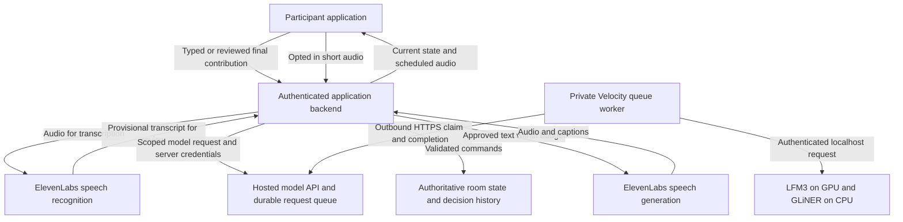

# Selected AI and speech architecture

Current prepared gameplay update: [gameplay HTTP contract](gameplay-api.md) now documents automatic reading, sequential speaking, ballots, CEO ties, results, ending and rejoin. Custom actions, final AI evaluation, audio capture and gameplay frontend integration remain separate. Historical foundation descriptions below retain their original evidence scope.

Status: selected implementation direction, November 7, 2026. This document governs provider selection, model responsibilities, and the AI integration boundary. [backend-spec.md](backend-spec.md) continues to govern confirmed multiplayer behavior. [TODO.md](../TODO.md) records implementation progress.

## 1. Required architecture

Use Route A: the application backend controls the exercise, local models interpret bounded requests, and ElevenLabs supplies speech input and output. These are eight logical responsibilities sharing state, not eight independent models or autonomous conversations.

1. Use ElevenLabs speech APIs for selected voice features. The current adapter uses `scribe_v2` for short recorded transcription and `eleven_flash_v2_5` for approved text to speech. These are adapter settings, not claims about the provider's newest models or current prices.
2. Use the existing hosted local model API for inference. `lfm3` maps to `LiquidAI/LFM3-1.7B`; `gliner-base` maps to `fastino/gliner2.5-base-v1`.
3. Keep identity, permissions, room state, voting, timers, scenario transitions, and decision records in the application backend. AI returns suggestions and validated data, never authority.
4. Keep typed input and captions usable when speech is disabled. Keep authored outcomes available when optional inference fails.
5. Do not introduce OpenRouter, a hosted commercial LLM fallback, or a managed ElevenAgents orchestrator as a substitute without a new user decision. Existing unrelated keys in a developer environment do not authorize their use.
6. Do not give teammates SSH access or distribute the owner's Velocity credentials. Their backend calls the hosted HTTPS API. Their application users need neither Velocity nor ChatGPT accounts.

The prior [architecture proposal](architecture.md) is retained for context. Its Route B, local speech alternatives, emotional analysis experiments, and proposed gameplay defaults are not selected production features. This document and the confirmed multiplayer specification resolve those ambiguities.

## 2. Boundaries and data flow

The hosted queue is an inference transport. Its database is not the multiplayer game's room database. The private worker uses outbound HTTPS, so the deployed model service does not depend on the owner's Mac, an exposed compute port, or a teammate's university login.

The existing prototype adapter can accept a selected short WAV and return a provisional transcript; this delivery makes no transcription call. Production microphone capture, transcription, original audio storage, and the complete voice client remain unimplemented. Temporary browser speech tokens are not enabled. Do not claim that the diagram is a fully deployed voice UI.

## 3. Agent roster and current implementation

1. Logical role: Preparation agent. Responsibility: Review scenario materials and prepare source references. Selected engine: Authored fixture and code now; shared LFM3 and GLiNER for later drafts. Current evidence and remaining work: `rehearsal/scenario.py` supplies a fictional fixture. Arbitrary document ingestion and generated scenario approval are not implemented..
2. Logical role: Facilitator agent. Responsibility: Give short updates and answer scoped questions. Selected engine: LFM3 plus backend validation. Current evidence and remaining work: `TransformersSelector.select_facts` selects only allowed fact IDs for prototype characters. The controller renders authored facts. The lab's free text generation is separate..
3. Logical role: Evaluation agent. Responsibility: Explain the recorded outcome using evidence known at the time. Selected engine: Deterministic debrief now; LFM3 drafts only after validation. Current evidence and remaining work: `Controller.debrief` cites actual records. Full multiplayer feedback and quality validation remain work under B12..
4. Logical role: Turn coordinator. Responsibility: Assign the floor and maintain the speaking queue. Selected engine: Code. Current evidence and remaining work: Prototype coordination controls exist. The production sequential speaking and voting flow remains B08 and related tasks..
5. Logical role: Discussion tracker. Responsibility: Extract names, tasks, deadlines, and contribution types. Selected engine: GLiNER2.5 Base on CPU plus deterministic checks. Current evidence and remaining work: `GlinerExtractor.extract` returns spans and advisory classes. Rule classifications are retained on disagreement; model output cannot confirm decisions..
6. Logical role: Timekeeper. Responsibility: Manage deadlines, pause state, and reminders. Selected engine: Code. Current evidence and remaining work: Prototype ticker and deadline tests exist. Production room and phase deadline handling remains part of B04, B08, and B11..
7. Logical role: Decision checker. Responsibility: Validate required fields and warn about ambiguity. Selected engine: Code; LFM3 only for future advisory interpretation. Current evidence and remaining work: Prototype proposal and chair confirmation checks exist. Production custom action outcome mapping is B10 and is not implemented by the generic model endpoint..
8. Logical role: Discussion climate observer. Responsibility: Suggest clarification, a recap, or inviting input. Selected engine: Code over discussion events. Current evidence and remaining work: Prototype suggestions exist. No emotion, personality, competence, or psychological scoring is enabled..

The initial fictional voices are the facilitator, IT support, and journalist. These are scoped personas using the same model and central speech queue. Staff and insurer personas are future content, not additional resident models.

The older Boardroom Mood Listener managed ElevenLabs agent and `ELEVENLABS_AGENT_ID` are not used by Route A. Do not connect the application to that legacy agent accidentally.

## 4. Model inventory

This is an implementation snapshot, not a benchmark or a guarantee that the allocation is still running. Check `GET /api/status` before live tests. Revisions and download checksums are recorded in [the download manifest](../cluster-downloads/download-status.json).

1. Repository: `LiquidAI/LFM3-1.7B`. Serving status: Enabled as `lfm3`; GPU. Intended use: Short dialogue and bounded interpretation.
2. Repository: `fastino/gliner2.5-base-v1`. Serving status: Enabled as `gliner-base`; CPU. Intended use: Entity spans and advisory classification.
3. Repository: `fastino/gliner2.5-small-v1`. Serving status: Downloaded only. Intended use: Smaller extraction candidate.
4. Repository: `openbmb/MiniCPM5-2B`. Serving status: Downloaded only. Intended use: Reasoning comparison.
5. Repository: `nvidia/NVIDIA-Nemotron-3.5-Bolt-E4B-BF16`. Serving status: Downloaded only. Intended use: Conversational comparison.
6. Repository: `ibm-granite/granite-4.2-3b`. Serving status: Downloaded only. Intended use: Document and tool use comparison.
7. Repository: `fastino/GLiNER2.5-Decide`. Serving status: Downloaded only. Intended use: Contribution classification candidate.
8. Repository: `LiquidAI/d1-2B`. Serving status: Downloaded only. Intended use: Typed decision queries requiring a dedicated adapter.
9. Repository: `numind/NuExtract3`. Serving status: Downloaded only. Intended use: Document extraction candidate.

One conversational model is resident on the assigned GPU. Do not load the remaining checkpoints concurrently, assume they share an interface, or list them as enabled before integration tests pass. Downloaded weights alone do not demonstrate suitability for custom action evaluation.

## 5. Production gameplay versus the prototype

The confirmed multiplayer specification takes precedence for gameplay: 3 to 30 participants, equal weight votes lasting 60 seconds, CEO selection among tied leaders, and automatic progression after a decision. Do not replace this with the prototype's chair confirmation flow.

The `rehearsal/` package is a working experimental controller with a three participant demo, an authored scenario, explicit chair confirmation, SQLite event history, and a local HTTP API. It is not the planned FastAPI room service, has no production vote implementation, and does not satisfy B01 through B13 by itself. Its 15 minute demo duration is not the production session default. Its fixture does not stand in for team approval of scenario package P02.

Use the prototype's permission checks, evidence snapshots, isolation, and idempotency tests as implementation references. The future backend should validate any generated custom outcome against the captured scenario, room, round, phase, job, and attempt. It alone applies authored narrative fact updates and next nodes. A late model response cannot change an ended game.

All human roles share the released scenario information required by the product specification. Scoped fictional character context and suppression of future unreleased events do not introduce private human player story facts.

## 6. Application integration contract

Read [agent-integration.md](agent-integration.md) for executable examples. The current hosted API provides `GET /api/status`, `POST /api/jobs`, and `GET /api/jobs?id=...`. It does not provide the future room endpoints, an OpenAI compatible chat endpoint, or an ElevenAgents Custom LLM endpoint.

The application's backend owns user authentication, room membership, and the mapping from each user to their model jobs. All requests made with the shared application key have one service identity. Never return its entire request history to an arbitrary application user.

Use an application request ID consistently when retrying submission. Store the queue job ID with the domain operation. Poll approximately every two seconds with a bounded timeout. Timeout is not cancellation: a queued job may finish later and must be ignored if its domain operation is stale.

Current limits are 4,000 prompt characters, 256 generated LFM tokens, 3 pending requests per identity, and 60 submissions per hour. The queue is shared and processes one inference at a time. The prototype client's 120 second wait is not a measured response guarantee. The product proposal of a 15 second AI deadline requires explicit handling of queue delay and late results; it has not been validated for the multiplayer application.

## 7. Speech and cost rules

1. Keep the permanent `ELEVENLABS_API_KEY` on the application backend. Never ship it to the browser or copy the developer's entire `.env.local` to teammates.
2. Submit only opted in audio. Review transcription before committing it under the authenticated participant identity. Partial text and diarization labels do not establish agreement or identity.
3. Speak approved text through one scheduler. Cancel or invalidate obsolete speech when interrupted or when its round ends. Record delivery only after actual playback completes.
4. Speech spending defaults to zero. Paid smoke tests need explicit authorization, a positive cap, and verified account pricing. The local reservation ledger is a conservative estimate, not a provider billing enforcement mechanism.
5. Keep generated speech cached and do not retry paid generations automatically. Speech failures retain readable captions and typed interaction.
6. The existing speech adapter has not passed a paid audio round trip in this project. Do not mark the live voice integration complete on the strength of an API key check or a text demo.

## 8. Availability and ownership

The existing model service uses allocation 20031 and is scheduled to end at **2026-11-08 15:46:25 UTC**, which is **November 8 at 10:46:25 AM Toronto**. The hosted portal and stored results can outlive that allocation; inference cannot. A new allocation requires owner authorization and a checked deployment update.

Normal application agents use only the HTTPS model API. Only an agent explicitly authorized to administer the owner's cluster may use [GPU_ACCESS.d](../GPU_ACCESS.d), after checking the live allocation. That document is an operations reference and grants no account access.

## 9. Evidence and next work

The November 7 implementation run verified 21 Python tests, a three participant controller demo, both hosted model responses, Python and Node clients, rejected invalid credentials, request deduplication, and conflict handling. Browser visual QA was unavailable. These are service and prototype checks, not a full multiplayer or speech acceptance test.

The next integration work belongs to the existing task IDs in [TODO.md](../TODO.md): B10 for validated custom action evaluation, B12 for final feedback, O02 for selected speech capability, and I01 through I04 for frontend contracts and real multiplayer verification. Keep those boxes unchecked until their own criteria pass and their implementation is published.

## Latest production evidence requirement

Production version 3 has no fixed numerical gameplay meters. The later evaluator must consider every committed individual answer, chat, reviewed speech transcript, and resolved or unresolved decision. Preserve unselected contributions, member identity, role at submission, round, phase, order, and source. The production evidence export is implemented; whole discussion AI scoring, context partitioning, and evaluation quality are not. The isolated playtest remains a separate prototype. Outcome captions and gated ElevenLabs narration integration are documented in [narrative-engine.md](narrative-engine.md); actual speech calls and audible playback still require the selected budget and client verification.

## Confirmed speaking recording requirement

Record every participant during their own speaking turn. While play continues, the application backend integrates ElevenLabs transcription and stores both the original audio and its transcript with authenticated member, room, round, speaking turn, and timestamps. The end screen shows the accumulated records and passes them to later AI evaluation. Participant identity comes from application membership and the authoritative turn, not a provider speaker label.

The current contribution endpoint accepts final reviewed transcript text only. It neither captures a microphone nor runs production transcription or stores original recordings. This requirement is documented for later implementation; it does not claim those capabilities now exist. The exact capture transport and storage backend remain unselected. Permanent provider keys remain on the backend, and the zero spending default, verified price, and authorized positive budget still apply before any paid call.

ElevenLabs documents both [file transcription](https://elevenlabs.io/docs/api-reference/speech-to-text/convert) and [speech recognition capabilities including realtime transcription](https://elevenlabs.io/docs/overview/capabilities/speech-to-text). These support the provider capability, without selecting this application's capture transport or storage design.
