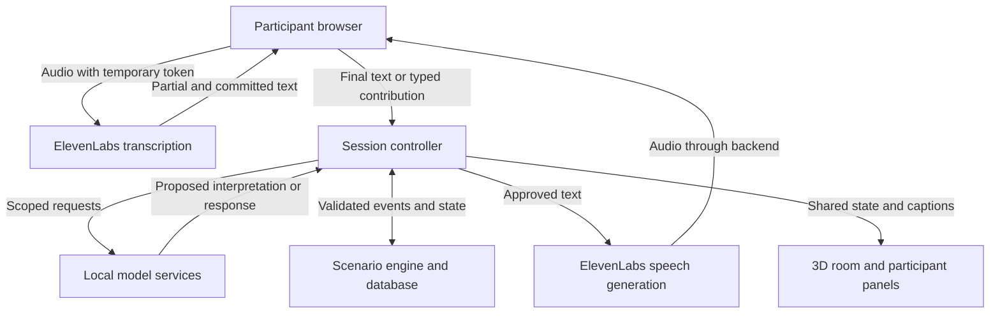
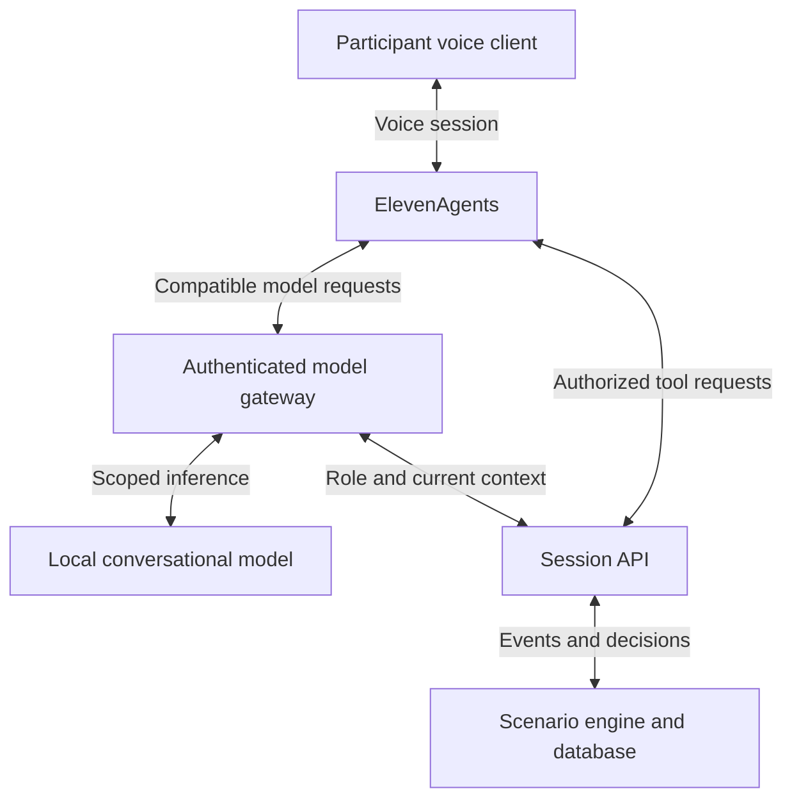

# Rehearsal: ElevenLabs and local agent architecture

**Team 22:** Arjun Behl, Jeff David Tieng and Ricardo Gao
**Partner:** Capacity Canada
**Updated:** November 7, 2026, America/Toronto
**Status:** Archived proposal and prototype rationale. The selected provider stack, current implementation, and eight role mappings are governed by [ai-architecture.md](ai-architecture.md). Confirmed multiplayer behavior is governed by [backend-spec.md](backend-spec.md). Optional Route B and gameplay defaults below are not adoption instructions. Paid speech and full multiplayer performance remain unverified.

## 1. The decision

Use **our backend as the controller**, **local models for reasoning and extraction**, and **ElevenLabs for speech input and output**.

Start with the separate ElevenLabs speech APIs. Add the full ElevenAgents platform later if its managed conversation features save integration work.

The product is a 15 minute group crisis rehearsal. Participants discuss an incident, consult fictional documents, confirm actions and receive a debrief. A cyber incident becomes more difficult when the executive director cannot be reached.

The eight agents below are **logical responsibilities**. They do not require eight models, eight servers or eight continuously running conversations.

## 2. Classify the system into four layers

| Layer | What belongs here | Where it runs |
|---|---|---|
| User experience | Participant controls, microphones, captions, raised hands, document viewer and 3D boardroom | Browser clients and existing Godot room |
| Voice | Speech recognition and generated facilitator/character speech | ElevenLabs cloud |
| Interpretation | Document analysis, extraction, dialogue, decision interpretation and debrief drafting | Team controlled model services on a laptop or allocated GPU server |
| Authority and memory | Participants, permissions, timers, speaking queue, scenario branches, confirmed decisions and event history | Application backend and database |

**Local inference does not make the entire application local.** With ElevenLabs enabled, microphone audio and text submitted for speech generation leave the device. Use fictional documents for the hackathon and make microphone capture visible and optional.

## 3. All eight agents and their connections

| # | Role | Inputs | Outputs | Local implementation candidate | ElevenLabs involvement |
|---|---|---|---|---|---|
| 1 | Preparation agent | Documents, role roster, scenario template | Reviewed organization profile, source references, missing information and scenario draft | Shared conversational model; GLiNER2.5 for extraction | None required |
| 2 | Facilitator agent | Current public situation, confirmed decisions, allowed next event, participant question | Short update, clarification or character response | Trial `LFM3-1.7B`; compare another model if it fails our scenarios | Speaks approved text; optionally receives transcribed questions |
| 3 | Evaluation agent | Event log, documents, rubric and information visible at each decision | Evidence linked findings and improvement actions | Shared model initially, subject to evaluation quality checks | Optional spoken summary |
| 4 | Turn coordinator | Raised hands, explicit finish/pass, chair invitations, accepted handoffs | Current speaker and queue | Code; model may suggest a handoff from language | AI interruption handling is useful, but does not assign board member authority |
| 5 | Discussion tracker | Final transcript segments or typed messages, attributed to participants | Questions, proposals, concerns, action owners, deadlines and supporting text spans | GLiNER2.5; conversational fallback for ambiguous context | Scribe provides transcripts |
| 6 | Timekeeper | Server deadlines, pause state, current round | Reminder or deadline expired event | Code | Optional spoken reminder |
| 7 | Decision checker | Draft action, discussion evidence, configured governance rules | Missing field warnings and proposed interpretation | Code first; optional Liquid d1 trial for semantic ambiguity | Speaks clarification requests |
| 8 | Discussion climate observer | Transcript, participation events, explicit participant feedback; optional audio | Suggestions to clarify, pause or invite input | Code plus shared model; optional emotion2vec+ experiment | Transcript input only in the initial design; no assumed mood scoring API |

### Important boundaries

1. The decision checker can propose that an action appears agreed. **Only an authenticated participant with the configured permission can finalize it.**
1. The facilitator cannot silently create new policy requirements, change old decisions or disclose future events.
1. The evaluator judges a decision using what participants knew at the time. It must not use a later surprise as evidence that they should have known better.
1. The climate observer offers suggestions. It does not score emotions, competence or personality.
1. Timers and queue updates do not wait for model calls.

## 4. Fictional characters

Start with two characters: **IT support** and **a journalist**. Add staff and an insurer representative if time permits.

| Character | Permitted information | Example interaction |
|---|---|---|
| IT support | Released technical findings and requests assigned to IT | “Which systems are unavailable?” |
| Journalist | The inquiry and public information available in the scenario | “What can you confirm at this point?” |
| Staff member | Service disruption and operational observations | “Can tomorrow's appointments continue?” |
| Insurance representative | The fictional policy excerpt and released document requests | “Which records does the exercise policy require?” |

Each character has a role prompt, an allowed information view and a voice identifier. They can share one conversational model.

Use a central speech scheduler so only one fictional character or facilitator speaks on the shared display at a time. Never let separate agent processes independently begin playback.

## 5. Recommended connection: our controller plus ElevenLabs speech APIs

This is **Route A**, recommended for the first prototype.



### What happens when someone speaks

1. The participant joins an authenticated session and deliberately enables their microphone.
2. The backend creates a temporary Scribe token. The permanent ElevenLabs API key remains server side.
3. The browser streams microphone audio to ElevenLabs.
4. Partial text is displayed as provisional captions. It does not finalize decisions or trigger scenario consequences.
5. A committed transcript segment is sent to the backend with a unique segment identifier. The server binds it to the authenticated participant.
6. The discussion tracker extracts a proposed interpretation. The backend stores the original text and supporting spans.
7. If the participant is addressing a character or facilitator, the controller provides that role with its permitted context.
8. The local model produces a response. The controller checks its structure, permissions and scenario consistency before publishing it. These checks reduce errors; they do not guarantee every generated sentence is correct.
9. Approved text is sent for speech generation and displayed as captions.
10. A decision changes the scenario only after the explicit confirmation workflow.

**Ordinary human to human discussion should not trigger an AI reply after every sentence.** Use a “Talk to facilitator” or “Call IT support” control to distinguish direct questions from group discussion.

### Why this route is useful

We control the exercise, dialogue triggers, shared audio and participant attribution. ElevenLabs provides speech services without becoming a second independent scenario controller.

A model on a private university network can stay private under this route **if our application backend can reach it**. ElevenLabs does not need to call that model directly.

## 6. Alternative: ElevenAgents connected to our local model

This is **Route B**, an alternative for managed voice conversations, not an extra speech pipeline to run simultaneously.

ElevenAgents can handle the voice session while calling our custom model gateway and application tools.



### Setup outline for Route B

1. Create a facilitator configuration in ElevenAgents and select its voice.
2. Choose **Custom LLM** and configure our gateway URL and model identifier.
3. Implement the compatible request/response format described in the official custom LLM documentation.
4. Keep role prompts and permitted scenario context under application control.
5. Add authenticated tools for permitted reads and draft proposals.
6. Map the ElevenLabs conversation to a server issued session and participant authorization.
7. Return confirmed application results before the agent claims an action succeeded.
8. Configure interruption handling and a conversation duration long enough for setup and the exercise. The application still owns round deadlines.
9. Confirm that transcript events, reconnection and tool calls enter our shared event log.

**Network requirement:** ElevenLabs must be able to reach the gateway and any webhook tools. A localhost address or VPN only university hostname will not work directly. Use an authenticated reachable gateway or a permitted tunnel; keep the actual inference service private. Check university deployment rules before exposing anything.

The current documentation says Custom LLM cannot be combined with ElevenLabs' separately named **Realtime model** mode. Custom LLM conversations can still be voice conversations; these are different configuration options.

**Avoid double orchestration:** choose whether the managed agent or our controller requests each inference. Do not make both independently generate the same reply.

## 7. Model services to start with

| Service | Starting candidate | Responsibilities | Decision before adoption |
|---|---|---|---|
| Conversational model | `LFM3-1.7B` trial | Facilitator, characters, preparation summaries and draft debriefs | Test instruction following, invented facts and supported serving runtime |
| Extraction model | `GLiNER2.5-base` | Actions, owners, deadlines and contribution classification | Test names, negation, pronouns and cross turn references |
| Optional decision specialist | Liquid `d1-2B` | Narrow typed questions about ambiguous contributions | Add only if it improves results over the shared model/code |
| Optional vocal expression model | emotion2vec+ base | Experimental speech expression signals | Evaluate separately; do not connect predictions to participant scores |
| Alternative local speech input | SenseVoiceSmall | Transcription when using a local speech route | Test audio quality and runtime compatibility before relying on it |

These are **candidates**, not a claim that their latest weights all run through the same runtime. Confirm each model's documented serving and quantization support. d1's typed decision interface needs its own adapter; do not assume it is a drop in chat endpoint.

Do not run SenseVoice and Scribe on every utterance by default. Choose one primary transcription path. A local fallback must be installed and tested before it can count as a fallback.

On Arjun's 16 GB M3 Mac, start with one suitably supported quantized conversational model and the small extractor, then measure total memory alongside the 3D application. On an allocated Velocity GPU, inference can run remotely, but an active allocation, connectivity and service health must be checked. This document does not verify current GPU availability.

Preparation and evaluation are not in the immediate voice response path. Run them before/after the exercise and use a stronger available model if the small model produces unsupported findings.

## 8. Suggested application interface

The following are **our proposed endpoints and tools**, not ElevenLabs SDK methods.

| Endpoint/tool | Purpose | Who may use it |
|---|---|---|
| `POST /sessions` | Create a session using an approved scenario | Organizer |
| `POST /sessions/:id/join` | Join and receive participant authorization | Invited participant |
| `POST /voice/scribe-token` | Obtain a temporary transcription token | Authenticated participant |
| `POST /sessions/:id/contributions` | Submit a committed segment or typed message | Its participant |
| `GET /sessions/:id/state` | Read the permitted current state | Session member |
| `get_public_situation` | Read released incident information | Facilitator/character with scoped access |
| `lookup_document_section` | Retrieve an allowed source passage | Authorized role |
| `propose_action` | Create a draft action | Participant or agent acting within its session |
| `POST /sessions/:id/decisions/:decisionId/confirm` | Finalize a reviewed action | Authorized human role |
| `POST /sessions/:id/debrief` | Produce the evidence linked report | Organizer or authorized session member |

Tool access must derive from server side authentication. Do not trust model generated participant IDs, role names or session IDs to establish permission.

Give agents read access and draft proposal access first. No tool should allow an AI to silently impersonate the chair or rewrite history.

## 9. Shared records

Use one authoritative event history. Store model interpretations separately from confirmed facts.

### Example committed contribution

```json
{
  "event_id": "evt_0042",
  "session_id": "session_demo",
  "participant_id": "participant_ricardo",
  "type": "contribution.committed",
  "source": "speech",
  "segment_id": "segment_0017",
  "text": "I can contact the insurer, if everyone agrees.",
  "interpretation": {
    "kind": "proposal",
    "suggested_owner": "participant_ricardo",
    "action": "Contact the insurer",
    "confirmed": false
  }
}
```

The server supplies the authenticated participant identity. The model's interpretation remains editable.

### Minimum records

| Record | Required information |
|---|---|
| Organization | Roles, governance rules, document sections, reviewed assumptions |
| Session | Participants, scenario version, current round, server deadline, state version |
| Contribution | Original text, identity, source, unique segment ID, proposed interpretation |
| Decision | Action, rationale, owner, confirmation identity/time, review time |
| Scenario event | Trigger, prerequisites, released information, consequence |
| Finding | Observation, event references, document references, uncertainty, proposed improvement |

Avoid treating a model's confidence value as a calibrated probability unless tested. Store the raw score separately if needed, with model and prompt versions.

## 10. Turn taking, silence and identity

There are two separate problems:

1. **Voice timing:** when the AI should speak, pause or stop after an interruption.
1. **Group coordination:** which participant has the floor and who can confirm a decision.

ElevenAgents can help with the first. Our queue and governance rules handle the second.

For the hackathon:

1. Prefer push to talk on each participant's signed in device.
2. Allow explicit raise hand, finish and pass controls.
3. Let the chair invite a participant or adjust the queue.
4. Do not interpret a short silence as agreement.
5. Do not infer identity from vocal expression.
6. If everyone uses one room microphone, require speaker selection or a separately tested attribution method. Speaker diarization labels are not automatically real names.
7. Prevent generated audio from re entering the transcript: use headsets where possible, echo cancellation and a controlled shared speaker arrangement.

On interruption, stop or cancel queued AI audio. Record whether an important update was actually delivered; do not silently assume participants heard the entire message.

## 11. Mood and participation boundaries

Call this role the **discussion climate observer**.

Useful signals include explicit requests for help, unanswered questions, overlapping speech, declined invitations and participant reported need for a pause.

A useful suggestion is:

> “Two questions remain unanswered. Offer a recap before asking for confirmation.”

An unsupported judgement is:

> “This participant is anxious and therefore made a poor decision.”

Optional audio expression analysis requires clear opt in and should remain separate from evaluation. No psychological diagnosis or personality score belongs in this prototype. Spoken discussion that was not captured must be marked unobserved.

## 12. Reliability and cost controls

| Failure | Expected behaviour |
|---|---|
| ElevenLabs unavailable | Show captions; accept typed input; use pre generated approved incident audio if available |
| Local model unavailable | Use the authored scenario and template responses; preserve session state |
| Extraction ambiguous | Ask for clarification; do not finalize the action |
| Voice arrives late | Keep the relevant update visible; discard speech for an obsolete round |
| Duplicate segment or click | Deduplicate using identifiers and return the original result |
| Participant reconnects | Restore current state and permitted event history |
| Budget threshold reached | Stop optional generations and continue in text/cached mode |

Keep the permanent ElevenLabs key and model gateway credentials on the server. Use the provider's temporary client token mechanism for supported browser transcription.

Choose a spending cap before testing. Measure actual usage for one complete 15 minute session. Existing credits and which products they cover must be checked in the account; this plan assumes no particular balance.

Cache approved fixed lines. Generate dynamic dialogue only when needed. Avoid automatic loops in which agents continuously talk to one another.

## 13. Build order

1. **Text only exercise:** three users join, propose an action, confirm it and see a state dependent consequence.
2. **Source backed debrief:** produce findings from that real event history.
3. **ElevenLabs output:** speak the opening and one fictional character response, with captions.
4. **Voice input:** add push to talk transcription and editable contributions.
5. **Local extraction:** connect GLiNER and compare its interpretations with expected outputs.
6. **Interactive character:** connect a local conversational model using a strictly limited character context.
7. **Coordination helpers:** queue, timer, decision prompts and climate suggestions.
8. **Optional additions:** d1, voice expression analysis or the managed ElevenAgents route.

### Division of work

1. **Arjun:** room, phone interaction, captions/audio playback and shared visual state.
1. **Jeff:** controller, scenario engine, event storage, model adapters and permissions.
1. **Ricardo:** joining, participant input, document review, confirmation and debrief screens.
1. **Together:** fictional scenario, test cases, integration and one full group playtest.

Assignments can be swapped according to skills. Agree on the event schema first.

## 14. Tests before the demo

1. “Maybe Jeff could call IT” remains a proposal.
1. “I agree we should discuss it” does not authorize the action.
1. “I will do it” requires enough context to identify the speaker and intended task.
1. An explicit authorized confirmation creates one decision, even after duplicate submission.
1. No character knows a future event or another character's private information.
1. A deferred decision stays visible and affects the correct later branch.
1. Partial transcripts never trigger final decisions.
1. All participants and the 3D room agree on current state after reconnect.
1. A voice interruption cannot lead to two simultaneous AI speakers.
1. The report cites actual events and document sections.
1. Three people can finish the exercise and identify an actionable plan change.
1. Record real end to end response latency and memory consumption; do not present publisher model latency as our application latency.

## 15. Verified capabilities and sources

Checked November 7, 2026. These sources establish product capabilities, not performance in our prototype.

1. [ElevenLabs text-to-speech](https://elevenlabs.io/docs/overview/capabilities/text-to-speech): streaming speech generation and voice model options.
2. [ElevenLabs transcription](https://elevenlabs.io/docs/overview/capabilities/speech-to-text): speech to text product capabilities. Do not assume batch features also exist in the realtime endpoint.
3. [Browser realtime transcription](https://elevenlabs.io/docs/eleven-api/guides/how-to/speech-to-text/realtime/client-side-streaming): partial/committed transcripts and temporary client tokens.
4. [ElevenAgents custom LLM](https://elevenlabs.io/docs/eleven-agents/customization/llm/custom-llm): custom model integration through compatible endpoints and mode restrictions.
5. [ElevenAgents webhook tools](https://elevenlabs.io/docs/eleven-agents/customization/tools/webhook-tools): authenticated calls to external application APIs.
6. [ElevenAgents conversation flow](https://elevenlabs.io/docs/eleven-agents/customization/conversation-flow): silence, interruptions and conversation timing.
7. [LFM3-1.7B](https://huggingface.co/LiquidAI/LFM3-1.7B): candidate conversational model.
8. [GLiNER2.5-base](https://huggingface.co/fastino/gliner2.5-base-v1): candidate extraction/classification model.
9. [Liquid d1-2B](https://huggingface.co/LiquidAI/d1-2B): typed decision model.
10. [emotion2vec+ base](https://huggingface.co/emotion2vec/emotion2vec_plus_base): optional speech expression experiment.
11. [SenseVoiceSmall](https://huggingface.co/FunAudioLLM/SenseVoiceSmall): optional local speech input route.

**Architecture to implement first:** Route A, one conversational model, one extractor, ElevenLabs speech services and one authoritative backend. Every additional role should share that state rather than inventing its own version of the exercise.
