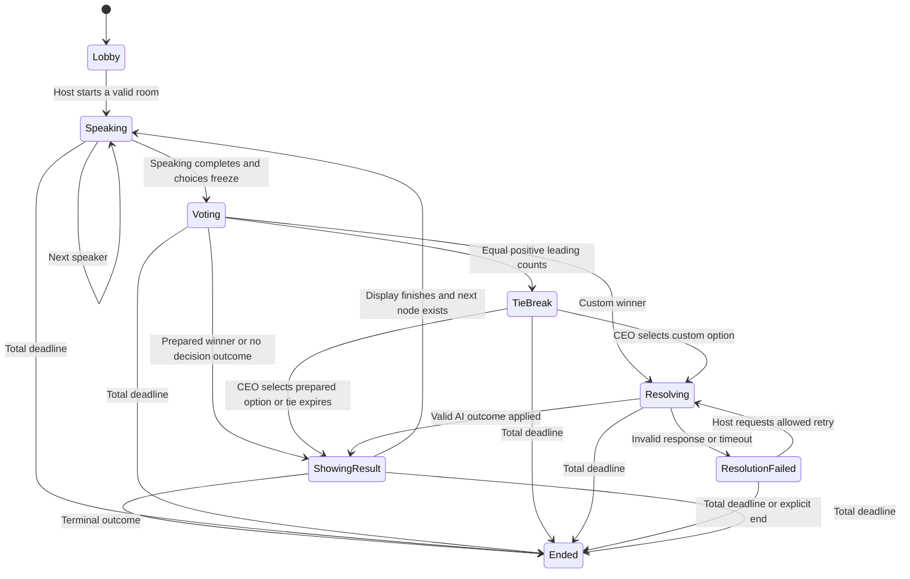

# Backend architecture

Status: proposed architecture, based on [the function specification](backend-spec.md). Its multiplayer type and interface sketches are not implemented application code. The existing prototype and hosted inference service are described in [ai-architecture.md](ai-architecture.md); their existence does not complete the room service.

## 1. Recommendation and rationale

Use one FastAPI service, one authoritative room object per meeting, and one short mutation path for each room. Keep scenario content immutable during play. Use HTTP for commands and WebSocket snapshots for live screens. AI runs outside room mutation and returns a result for the server to validate and apply.

This concentrates voting, timers, speaker order, and consequences behind one room interface. The frontend sends intentions rather than calculating winners or advancing the story. Each room is independent; coordination is needed only among players who actually share that room.

In practice, begin with one FastAPI service. The backend maintains one authoritative state per room. Clients submit actions, and the backend handles speaking, voting, ties, and story progression before synchronizing the result to all players. AI returns an evaluation without directly modifying the room.

## 2. Frontend usage first

The following is a proposed contract, not a claim that these endpoints exist.

```text
POST /api/rooms
{ "scenario_id": "cybersecurity_example", "scenario_version": 1,
  "display_name": "Alex", "settings": { "speaker_seconds": 30, "session_seconds": 1800 } }

Response: room_id, room_code, member_id, room_view, membership cookie

POST /api/rooms/join
{ "room_code": "K7MPQ2", "display_name": "Ricardo" }

Response: member_id, room_view, membership cookie

PUT /api/rooms/{room_id}/rounds/{round_id}/vote
{ "command_id": "unique-client-command", "phase_id": "current-phase", "option_id": "option-2" }

Response: accepted receipt and room_version
```

The example scenario ID and durations are illustrative, not supplied content or accepted defaults. Every state changing request carries a `command_id`. Phase specific actions also carry the current `round_id` and `phase_id`.

The browser receives membership through a same origin cookie, then connects to `/ws/rooms/{room_id}`. A reconnect gets a complete snapshot for the same member. The display name is never an authentication credential.

## 3. Proposed module map

```text
backend/
  app/
    main.py          Application creation and lifespan
    api.py           HTTP routes, socket admission, wire models and projections
    models.py        Domain identifiers, phase variants and decision records
    rooms.py         Sole room mutation owner, membership, timers and receipts
    simulation.py    Pure phase transitions and authored outcome application
    scenarios.py     Package loading, validation and immutable version lookup
    intelligence.py  AI provider calls and output validation
  scenarios/         Reviewed, versioned scenario packages and documents
  tests/             Domain, concurrency, API, socket and provider contract checks
```

This is a future layout, not a directory scaffold added by this task. Start with these modules rather than separate deployed services. Split a module later only when a clear ownership boundary emerges.

`rooms.py` is the only writer of mutable game state. `simulation.py` returns a transition from an input state and command. `intelligence.py` returns evaluated data. `api.py` authenticates and translates requests without owning game rules. `scenarios.py` is the owner of package validity and version references.

## 4. Domain shapes

Use distinct variants instead of one record with optional fields for every phase. The sketch below describes fields rather than a complete Python implementation.

```text
PreparedOption = {kind: "prepared", id, label, outcome_id}
CustomOption   = {kind: "custom", id, text, author_member_id}
Option         = PreparedOption | CustomOption

Lobby          = {kind: "lobby"}
Speaking       = {kind: "speaking", phase_id, round_id, speaker_order,
                  current_speaker_id, speaker_deadline, custom_proposals}
Voting         = {kind: "voting", phase_id, round_id, options,
                  eligible_member_ids, ballots_by_member, vote_deadline}
TieBreak       = {kind: "tie_break", phase_id, round_id,
                  tied_option_ids, ceo_member_id, tie_deadline}
Resolving      = {kind: "resolving", phase_id, round_id,
                  selected_option, job_id, attempt_id}
ResolutionFailed = {kind: "resolution_failed", phase_id, round_id,
                    selected_option, attempts_used, reason}
ShowingResult  = {kind: "showing_result", phase_id, round_id,
                  decision_id, display_deadline}
Ended          = {kind: "ended", reason, ended_at, final_record}
Phase          = Lobby | Speaking | Voting | TieBreak | Resolving |
                 ResolutionFailed | ShowingResult | Ended

Member         = {id, display_name, role_id, connection_ids}
DecisionRecord = {id, round_id, node_id, selected_option, vote_tally,
                  resolution_source, outcome_id, applied_deltas, resolved_at}
RoomState      = {id, code, room_version, scenario_version, members,
                  host_member_id, phase, metrics, decisions, session_deadline}
FeedbackState  = Pending | Ready | Failed
```

A prepared choice has an outcome ID; a custom choice has an author and text. Do not represent those differences with unchecked nullable fields. A credential registry and command receipts remain private runtime data. They are never serialized in a room snapshot.

All visible scenario information is shared across roles. A member's own ballot and permissions may vary in the snapshot without introducing private story facts. Hide future consequences until they occur as a proposed presentation rule.

## 5. Deep public interface

```python
class Rooms:
    async def create(self, request: CreateRoom) -> CreatedRoom:
        raise NotImplementedError

    async def join(self, request: JoinRoom) -> JoinedRoom:
        raise NotImplementedError

    async def execute(self, member: VerifiedMember, command: PlayerCommand) -> Receipt:
        raise NotImplementedError

    async def snapshot(self, member: VerifiedMember) -> RoomView:
        raise NotImplementedError

    async def observe(self, member: VerifiedMember) -> AsyncIterator[RoomView]:
        raise NotImplementedError

def transition(state: RoomState, command: DomainCommand, now: ClockReading) -> Transition:
    raise NotImplementedError

class Intelligence:
    async def decide_custom(self, request: CustomDecisionRequest) -> EvaluatedOutcome:
        raise NotImplementedError

    async def final_feedback(self, request: FeedbackRequest) -> Feedback:
        raise NotImplementedError
```

These signatures are the design contract only. The provider interface uses product concepts, not a provider SDK's raw response. The room facade hides vote deduplication, deadlines, phase checking, AI callbacks, and public state projection.

## 6. State progression



The diagram shows principal paths. A permitted host end action can end any active phase. Ending is terminal for gameplay. Final feedback can complete afterward without reopening the room's gameplay state.

Proposed: terminal outcomes enter `Ended` as soon as their decision record is committed, with the final record containing the result. The result display delay applies only when another decision node follows. This avoids waiting five extra seconds to recognize a completed scenario.

## 7. Command correctness and concurrency

Each room has a short `asyncio.Lock` on its one event loop. Different rooms use different locks. All routes, deadline callbacks, and AI callbacks enter the same mutation method.

Within that method:

1. Authenticate the caller and identify the room. Client supplied member IDs do not grant authority.
2. Acquire the room lock. Reconcile elapsed deadlines first, with total game expiry taking precedence.
3. Check the receipt for this member and `command_id`. An exact retry returns its prior result. Reusing an ID with a different request body is a conflict.
4. Check the current phase and round. A stale request is rejected. Do not require clients to send the current global room version for every vote, because concurrent voters would unnecessarily invalidate each other.
5. Compute and apply one transition. Vote data is keyed by member ID. Closing a round consumes its phase exactly once.
6. Increment `room_version` for a committed state change, record the command result, and capture any required side effects.
7. Release the lock, then publish snapshots or run external AI work.

Never await a provider request or send to a slow socket while holding the mutation lock. Every room update carries a complete projected snapshot and its version. Clients discard older versions; they do not need to reconstruct state from every intermediate event.

A slow client gets a bounded outgoing queue. On overflow, close that connection and let it rejoin for a fresh snapshot. A failed broadcast does not undo a committed decision.

The timer checks a monotonic internal clock. Snapshots expose UTC deadlines and server time for display. Each timer captures its room, round, phase ID, and expected deadline. A stale callback is a no op. A wakeup is only a reminder to recheck time, not authority to advance whichever round happens to be current.

The eligibility roster and final choices are immutable during voting. At the cutoff, count accepted ballots, then choose the unique leader, CEO tie phase, or explicit no decision outcome. An old socket, an extra browser tab, or a retried request cannot create another vote.

## 8. AI job lifecycle

A custom winner enters `Resolving`, which records a unique job and attempt ID. The request captures the scenario version, node, selected proposal, current metrics, rubric, and decision history. Network work runs outside the room lock.

The provider returns an allowed `outcome_id`, narrative, and rubric assessment. Structured shape validation uses [Pydantic](https://docs.pydantic.dev/latest/concepts/models/). The application separately verifies outcome membership and the captured scenario and phase identity. Only then does the room apply the authored deltas and next node.

The completion must still match the active room, round, phase, job, and attempt. The room must still be in the corresponding resolving phase, and the total deadline must not have elapsed. A late response from a timed out attempt cannot win over a retry. Duplicate completions cannot apply an outcome twice.

Provider timeout and output failure enter a visible error state. An explicit retry creates a new attempt ID. Gameplay remains subject to the original total deadline. The final feedback request uses the frozen final record, so later AI prose cannot rewrite what happened.

AI assessment is allowed to map a custom action to an authored outcome. That mapping policy is a Proposed product choice. Provider selection is now Route A: the hosted LFM3 and GLiNER service for local inference and ElevenLabs for speech. See [ai-architecture.md](ai-architecture.md) for the exact boundary. The generic model queue does not implement this typed custom outcome contract; B10 must validate and adapt its responses. No extra autonomous agent framework is required.

## 9. Proposed API catalog

1. `GET /api/scenarios`: available reviewed packages and public descriptions.
2. `GET /api/scenarios/{scenario_id}/versions/{version}`: public briefing and role definitions, excluding future outcome details.
3. `POST /api/rooms`: create the room and host seat.
4. `POST /api/rooms/join`: code and nickname entry, or return the caller's existing membership when applicable.
5. `GET /api/rooms/{room_id}`: authorized current snapshot, also used for rejoin synchronization.
6. `PUT /api/rooms/{room_id}/members/{member_id}/role`: host role assignment in the lobby, or the narrowly permitted CEO reassignment during a tie.
7. `POST /api/rooms/{room_id}/start`: validate settings, roster, CEO, and scenario, then begin.
8. `POST /api/rooms/{room_id}/rounds/{round_id}/speaker/finish`: current speaker finishes early, or host skips under the selected policy.
9. `PUT /api/rooms/{room_id}/rounds/{round_id}/proposal`: create or replace the authenticated member's custom proposal during speaking.
10. `DELETE /api/rooms/{room_id}/rounds/{round_id}/proposal`: withdraw that member's proposal before freeze, with command metadata in the request body.
11. `PUT /api/rooms/{room_id}/rounds/{round_id}/vote`: create or replace the authenticated member's ballot before cutoff.
12. `POST /api/rooms/{room_id}/rounds/{round_id}/tie-decision`: CEO selects a tied leader.
13. `POST /api/rooms/{room_id}/rounds/{round_id}/resolution/retry`: host requests the allowed AI retry.
14. `POST /api/rooms/{room_id}/end`: explicit host end with reason.
15. `GET /api/rooms/{room_id}/report`: frozen factual result and feedback status.
16. `WS /ws/rooms/{room_id}`: authenticated snapshots, server time, phase deadlines, and presence.

All state changing operations carry `command_id`; round operations carry `phase_id`. Use `401` for absent membership, `403` for wrong permission, `404` for unavailable rooms, `409` for stale phase or command reuse conflict, and `422` for malformed or invalid domain input. Exact error codes and response examples belong in the implementation's generated OpenAPI contract.

ElevenLabs speech is selected under Route A, but live media endpoints and browser integration are still unimplemented. Define and test their contract under O02 rather than presenting proposed endpoints as working features.

## 10. Storage and deployment choices

Recommended first shape: one backend process and active rooms in memory. Scenario files remain immutable versioned inputs. Browser refresh and reconnect recover the seat while that process lives. Process restart recovery is not provided. This matches the user's decision to defer advanced recovery. FastAPI explicitly documents the process lifetime and single process limitation of its [memory based WebSocket example](https://fastapi.tiangolo.com/advanced/websockets/).

Run one worker for this shape. A reverse proxy may serve the frontend and route `/api` and `/ws` to the backend under the same origin. This is a recommended deployment shape, not a selected hosting provider. An active room continues while temporarily empty. Cleanup may remove expired lobbies and ended rooms according to an explicitly chosen retention setting, not merely because a socket closed.

The target logical database model, if durable storage is selected later, contains:

1. `scenario_versions`: immutable package identity, content, checksum, and publication status.
2. `rooms`: scenario reference, settings, current phase, version, deadlines, metrics, and ending.
3. `members`: room, display name, role, and membership credential reference. Unique seat identity is separate from display name.
4. `rounds`: room, decision node, phase identity, frozen electorate, and deadlines.
5. `options`: round, kind, author where applicable, frozen text, and prepared outcome reference where applicable.
6. `votes`: round, member, selected option, and update time, unique by round and member.
7. `decisions`: round resolution, selected option, outcome, applied metrics, and provenance, unique by round.
8. `command_receipts`: room, member, command ID, request hash, and prior response, unique within that command scope.
9. `ai_jobs` and `reports`: attempt identity, status, frozen input reference, validated output, and final feedback.

Do not share one mutable database session among concurrent tasks; SQLAlchemy documents a [separate session per concurrent task](https://docs.sqlalchemy.org/en/20/orm/session_basics.html#is-the-session-thread-safe-is-asyncsession-safe-to-share-in-concurrent-tasks). No database package or schema migration is installed by this design task.

Durable deployment needs a transaction that atomically commits room version, decision, receipt, and pending job state, plus exclusive ownership or compare and swap for room transitions and a shared event transport. It also needs recovery of pending jobs and deadlines. A database alone does not make multiple independent room writers correct. This larger deployment remains deferred.

## 11. Alternative comparison and synthesis

Two fresh design agents produced independent candidates. Available tools expose OpenAI models, so both used the inherited model. A different model family judge was unavailable. Final comparison and synthesis were performed by the main agent.

Candidate A used a room aggregate with a short mutation lock. Candidate B used one actor and command queue per room, with explicit events. Both preserved confirmed multiplayer, voting, speaking, custom actions, and basic rejoin. Both also proposed evaluating custom ideas before voting, which is not a confirmed requirement.

The comparison scored faithfulness, concurrency, bounded AI behavior, implementation footprint, and frontend recovery from 1 to 5. Candidate A scored 4, 4, 3, 5, 4. Candidate B scored 4, 5, 3, 3, 4. These are design judgments, not runtime measurements.

Choose A as the base because it keeps one room write boundary with less lifecycle machinery. Graft B's explicit phase identity, stale callback checks, bounded outbound delivery, and active room lifetime independent of sockets. Use HTTP mutations for a visible typed API contract, with the same internal command path handling timers and AI completions.

Replace both candidates' evaluation of every custom proposal before voting with evaluation of only the selected custom action. This is a proposed cost and latency tradeoff, consistent with the discussion of reducing usage. Keep the custom option visible and report evaluation failure honestly.

Reject a client owned simulation because clients could disagree about deadlines and winners. Reject separate AI, vote, and room services because they distribute one shared decision across multiple owners before scale requires it. Keep the actor alternative available if command admission and orchestration grow enough to justify its queue and lifecycle complexity.

## 12. Next implementation unit and evidence boundary

After architecture approval, the first unit is a pure room transition test fixture containing three members, one prepared scenario node, one 60 second vote, and a CEO tie case. Then expose creation, join, start, vote, and snapshots before extending to the full selected function set.

The specification's acceptance examples define required multiplayer implementation checks. The separate prototype and hosted model service have executed tests and inference, but they do not implement this FastAPI room architecture. Keep B01 through B13 and the multiplayer integration tasks open until their own acceptance criteria are met.
