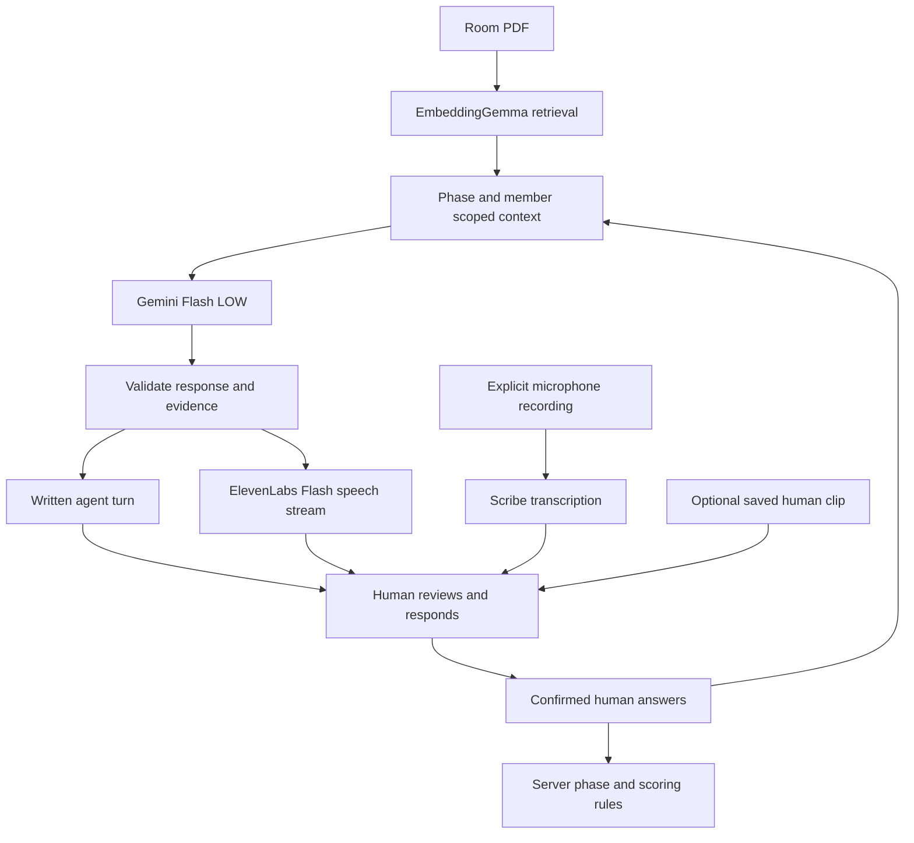

# How the four round AI workflow works

Latest X25: [all recordings for your private round are visible and playable](ROUND_RECORDING_LIBRARY.md), including all three choices in Gemini Live. Use port 8793 for the updated backend; older rooms remain on their previous ports.

Earlier X24: [test Alex alone with a finite recorded sequence](SOLO_SEQUENCE_GUIDE.md). Use port 8792 and **Load Alex only**. Three coaching clips stop at card review; three assessment clips stop at personal results. No Morgan or Sam session is required. The three member group mode remains optional.

Earlier X23: [saved clips can speak into Gemini Live](RECORDED_LIVE_AND_SECTIONS.md) without microphone access. Only introduction and discussion sections can end early; decisions, private answers and reviewed cards remain mandatory. X23 test server: port 8791.

Historical X22 offered whole round bypasses. X23 removes them and retains required decisions and answers.

Earlier X21: [optional Gemini Live private audio](LIVE_AUDIO_WORKFLOW.md) adds explicit microphone conversation in Rounds 2 and 3, native Gemini speech and reviewed transcript drafts. Use port 8789 for the updated local test server. Ordinary speech remains Gemini plus ElevenLabs.

Current branch: `experiment/ai-voice-playtest`. New rooms use `flow: four_rounds`. The beta is a working three member exercise using **Service outage and unavailable director**, the public T01 Cedar Bridge Community Services report. Start with [the controls guide](ROUNDTABLE_GUIDE.md). [The design](FOUR_ROUND_DESIGN.md) preserves the full requested experience.

## From the PDF to the agent's voice

1. The selected PDF is extracted and indexed by the cached local `google/embeddinggemma-2` model. Embeddings retrieve relevant passages; they do not write dialogue. Searches and downloads are scoped to this room's attached documents. The hidden controller reference and test answers are excluded from retrieval.
2. The backend builds the context for the current role and phase. Shared preparation and experts receive the public report and discussion. A private coach receives the public report, expert advice, this member's original decision, their own discussion contributions and their own private history. Other members' private answers are excluded.
3. Vertex Gemini 3.8 Flash with LOW reasoning writes the response. No local conversation model API is used. The same private agent identity continues from coaching to examination; its instructions change explicitly at assessment.
4. During shared Round 1, Gemini text streams through the backend and completed sentences are sent to ElevenLabs Flash v2.5. During private coaching, cards, scoring and reunion, Gemini first returns structured JSON, which the backend validates. The complete validated written turn appears, then ElevenLabs streams its sentences as PCM audio. Private text is therefore not token streamed before validation.
5. Audio plays in the requesting browser. Text remains readable if speech fails or is stopped. **Speak with ElevenLabs** controls live speech; typed interaction works without it. Separate browsers do not receive a synchronized conference audio broadcast.
6. A person answers by typing, using a saved fictional human clip, or explicitly recording microphone input. Scribe v2 transcribes a requested microphone clip. The person corrects the text and confirms submission; neither transcription nor playback submits an answer automatically.
7. Server code validates membership, phase, revision and allowed action. It stores the submitted answer, moves the phase and computes score totals from validated rubric values. Gemini cannot submit a human answer, change another branch, cast a vote or declare its own winner.

## Each round

| Round | AI interaction | Human action and server gate |
| --- | --- | --- |
| 1 | Preparation introduces the report; facilitator helps discussion; IT/security, operations/community services and governance/finance give live perspectives | Each person reviews and submits action, reasoning, evidence and unknowns. The CEO starts private sessions only after all three submissions. No points. |
| 2 | One crisis coach introduces the unavailable IT specialist, asks three questions and drafts a seven field response card | Each answer is confirmed. The member edits and confirms action, responsibility, evidence, dependencies, fallback, communication and review. No points. |
| 3 | The same agent explicitly becomes examiner, asks three staged questions and assesses submitted evidence | Only Round 3 answers earn points. Stage maxima are 30, 40 and 30. Numeric points appear after each stage; detailed reasons appear after that member finishes assessment. |
| 4 | The facilitator compares separate branches with one strength and improvement per member | Members inspect evidence, optionally request correction using an existing Round 3 quote, and confirm review. The CEO announces the highest final score only after every review and a current summary. Ties produce joint winners. Reflections earn no new points. |

The coach and examiner are one conversational partner, not separate experts joining a private room. In independent participant browsers, the three sessions can progress concurrently. In the single window test bundle, select a member to work through that private branch, then select the next. The all member reunion barrier prevents early disclosure of unfinished private sessions.

## Predictable beta mode and adaptive mode

**Beta test mode** is on by default. The CEO can switch it off in the lobby before Start. Its setting stays fixed for the exercise so one member cannot receive a different test after another has started.

Beta uses the same approved twists and canonical question order as the saved clips. Gemini provides short acknowledgements and drafts the response card; examiner questions use the canonical text. Gemini sampling temperature is zero for these requests and for rubric scoring. This improves repeatability but does not guarantee identical generated wording or points across provider versions or repeated runs. Scores remain evidence based live model judgments, not fixed rewards for selecting a recording.

With beta mode off, Gemini uses temperature 0.3 for coaching and examiner questions and adapts one question at a time to the member's response. Approved twists, stage purpose, isolation and scoring rules remain fixed. Scoring continues at temperature zero. A saved answer may no longer answer the adapted question; edit it or use your own answer. You can stop using recordings at any stage without disabling beta mode.

The approved scenario developments are: the IT specialist is unavailable; the alternate provider needs an authorized contact; during assessment that provider cannot begin immediately and staff still need instructions. The model must leave other unknowns unresolved. The public PDF does not automatically grant a provider access or prove a backup works.

## Recordings and input review

The current exercise offers **36 human clips**: nine existing Round 1 discussion turns, three individual decision clips, nine coaching answers, nine assessment answers and six reunion reflections. The new 27 assets were generated with ElevenLabs using the existing three participant voices. They are labelled fictional demo recordings. None is a prerecorded AI reply.

The server only offers clips matching the authenticated member, current round and question. Playing the audio starts an expiring lease. The file must be served and its duration elapsed before the caption can become a review draft. Submission remains a separate human command. Changing stage invalidates the lease; another member cannot retrieve it. Replays use saved MP3 files and make no model or speech generation call.

A prerecorded answer is a test fixture, not evidence of a real person's competence. Typed edits remain possible. Submitted private answers record whether a completed recording lease was used. The live benchmark uses scripted typed fixture captions and labels that method explicitly.

## Scoring and corrections

Each of the ten criteria is an integer from zero to ten. Every positive award requires an exact quote from that submitted Round 3 answer. Invalid criteria, points outside bounds or fabricated quotes reject the scoring response and preserve the answer for an explicit retry. The server calculates totals, enforces 100 maximum, and chooses the winner from finalized totals.

Rubric interpretation still depends on Gemini. Quote validation proves the evidence exists; it does not prove the judgment is fair. Round 2 guidance, speaking speed, confidence and accent do not earn points. The examiner receives the current Round 3 answer, relevant documents and the stage question, rather than coaching answers for credit.

During reunion, each member can flag one passage per stage from their own existing assessment answer. Gemini reassesses that same answer with the highlighted quote. A completed correction records previous and new scores and invalidates the summary. A failed correction retains the prior score and must be retried or withdrawn before review confirmation. New arguments and reunion reflections cannot earn points.

## Limits and recovery

This is a local test application with exactly three members and the included T01 report. Rooms are held in process memory; export before restarting. Role and bearer membership controls support prototype isolation, not production identity or durable storage. The single window test bundle intentionally holds all three identities.

Preparation lasts 30 seconds and group discussion allows up to five minutes with early finish. The expert stage, private turns and reunion wait for explicit actions; the proposed 15 minute schedule is not an enforced total timer. There is no automatic answer submission on timeout.

Provider failures retain submitted answers and valid scores. Retry explicitly using the agent button. Stop voice cancels client playback; already completed text or scoring may still be stored. Existing usage reservations remain in persistent unlimited ledgers under the user's authorization. No GPU access is required.
