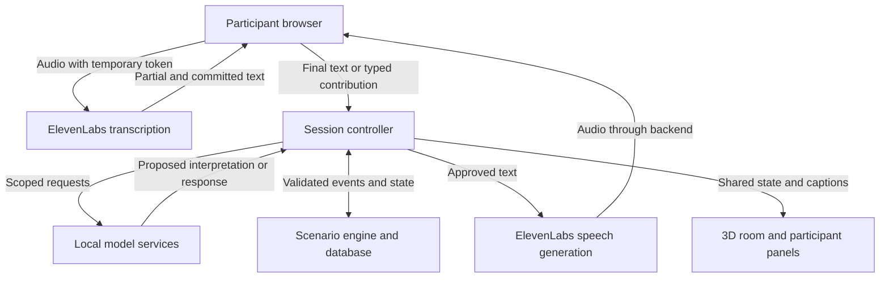
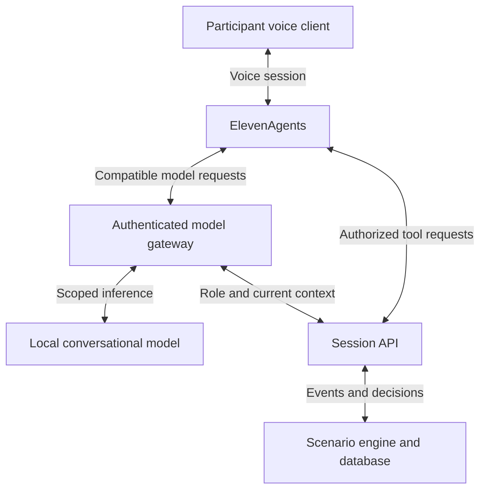

# Rehearsal: ElevenLabs and local-agent architecture

**Team 22:** Arjun Behl, Jeff David Tieng and Ricardo Gao
**Partner:** Capacity Canada
**Updated:** November 7, 2026, America/Toronto
**Revision 2:** Added three source-grounded fictional test packs, four public source documents, retrieval checks and expected agent behaviours. See sections 16–21.
**Status:** Implementation proposal. Models, latency, deployment compatibility and costs have not been benchmarked for this application.

## 1. The decision

Use **our backend as the controller**, **local models for reasoning and extraction**, and **ElevenLabs for speech input and output**.

Start with the separate ElevenLabs speech APIs. Add the full ElevenAgents platform later if its managed conversation features save integration work.

The product is a 15-minute group crisis rehearsal. Participants discuss an incident, consult fictional documents, confirm actions and receive a debrief. A cyber incident becomes more difficult when the executive director cannot be reached.

The eight agents below are **logical responsibilities**. They do not require eight models, eight servers or eight continuously running conversations.

## 2. Classify the system into four layers

| Layer | What belongs here | Where it runs |
|---|---|---|
| User experience | Participant controls, microphones, captions, raised hands, document viewer and 3D boardroom | Browser clients and existing Godot room |
| Voice | Speech recognition and generated facilitator/character speech | ElevenLabs cloud |
| Interpretation | Document analysis, extraction, dialogue, decision interpretation and debrief drafting | Team-controlled model services on a laptop or allocated GPU server |
| Authority and memory | Participants, permissions, timers, speaking queue, scenario branches, confirmed decisions and event history | Application backend and database |

**Local inference does not make the entire application local.** With ElevenLabs enabled, microphone audio and text submitted for speech generation leave the device. Use fictional documents for the hackathon and make microphone capture visible and optional.

## 3. All eight agents and their connections

| # | Role | Inputs | Outputs | Local implementation candidate | ElevenLabs involvement |
|---|---|---|---|---|---|
| 1 | Preparation agent | Documents, role roster, scenario template | Reviewed organization profile, source references, missing information and scenario draft | Shared conversational model; GLiNER2.5 for extraction | None required |
| 2 | Facilitator agent | Current public situation, confirmed decisions, allowed next event, participant question | Short update, clarification or character response | Trial LFM3-1.7B; compare another model if it fails our scenarios | Speaks approved text; optionally receives transcribed questions |
| 3 | Evaluation agent | Event log, documents, rubric and information visible at each decision | Evidence-linked findings and improvement actions | Shared model initially, subject to evaluation-quality checks | Optional spoken summary |
| 4 | Turn coordinator | Raised hands, explicit finish/pass, chair invitations, accepted handoffs | Current speaker and queue | Code; model may suggest a handoff from language | AI interruption handling is useful, but does not assign board-member authority |
| 5 | Discussion tracker | Final transcript segments or typed messages, attributed to participants | Questions, proposals, concerns, action owners, deadlines and supporting text spans | GLiNER2.5; conversational fallback for ambiguous context | Scribe provides transcripts |
| 6 | Timekeeper | Server deadlines, pause state, current round | Reminder or deadline-expired event | Code | Optional spoken reminder |
| 7 | Decision checker | Draft action, discussion evidence, configured governance rules | Missing-field warnings and proposed interpretation | Code first; optional Liquid d1 trial for semantic ambiguity | Speaks clarification requests |
| 8 | Discussion-climate observer | Transcript, participation events, explicit participant feedback; optional audio | Suggestions to clarify, pause or invite input | Code plus shared model; optional emotion2vec+ experiment | Transcript input only in the initial design; no assumed mood-scoring API |

### Important boundaries

- The decision checker can propose that an action appears agreed. **Only an authenticated participant with the configured permission can finalize it.**
- The facilitator cannot silently create new policy requirements, change old decisions or disclose future events.
- The evaluator judges a decision using what participants knew at the time. It must not use a later surprise as evidence that they should have known better.
- The climate observer offers suggestions. It does not score emotions, competence or personality.
- Timers and queue updates do not wait for model calls.

## 4. Fictional characters

Start with two characters: **IT support** and **a journalist**. Add staff and an insurer representative if time permits.

| Character | Permitted information | Example interaction |
|---|---|---|
| IT support | Released technical findings and requests assigned to IT | “Which systems are unavailable?” |
| Journalist | The inquiry and public information available in the scenario | “What can you confirm at this point?” |
| Staff member | Service disruption and operational observations | “Can tomorrow's appointments continue?” |
| Insurance representative | The fictional policy excerpt and released document requests | “Which records does the exercise policy require?” |

Each character has a role prompt, an allowed information view and a voice identifier. They can share one conversational model.

Use a central speech scheduler so only one fictional character or facilitator speaks on the shared display at a time. Never let separate agent processes independently begin playback.

## 5. Recommended connection: our controller plus ElevenLabs speech APIs

This is **Route A**, recommended for the first prototype.



### What happens when someone speaks

1. The participant joins an authenticated session and deliberately enables their microphone.
2. The backend creates a temporary Scribe token. The permanent ElevenLabs API key remains server-side.
3. The browser streams microphone audio to ElevenLabs.
4. Partial text is displayed as provisional captions. It does not finalize decisions or trigger scenario consequences.
5. A committed transcript segment is sent to the backend with a unique segment identifier. The server binds it to the authenticated participant.
6. The discussion tracker extracts a proposed interpretation. The backend stores the original text and supporting spans.
7. If the participant is addressing a character or facilitator, the controller provides that role with its permitted context.
8. The local model produces a response. The controller checks its structure, permissions and scenario consistency before publishing it. These checks reduce errors; they do not guarantee every generated sentence is correct.
9. Approved text is sent for speech generation and displayed as captions.
10. A decision changes the scenario only after the explicit confirmation workflow.

**Ordinary human-to-human discussion should not trigger an AI reply after every sentence.** Use a “Talk to facilitator” or “Call IT support” control to distinguish direct questions from group discussion.

### Why this route is useful

We control the exercise, dialogue triggers, shared audio and participant attribution. ElevenLabs provides speech services without becoming a second independent scenario controller.

A model on a private university network can stay private under this route **if our application backend can reach it**. ElevenLabs does not need to call that model directly.

## 6. Alternative: ElevenAgents connected to our local model

This is **Route B**, an alternative for managed voice conversations, not an extra speech pipeline to run simultaneously.

ElevenAgents can handle the voice session while calling our custom model gateway and application tools.



### Setup outline for Route B

1. Create a facilitator configuration in ElevenAgents and select its voice.
2. Choose **Custom LLM** and configure our gateway URL and model identifier.
3. Implement the compatible request/response format described in the official custom-LLM documentation.
4. Keep role prompts and permitted scenario context under application control.
5. Add authenticated tools for permitted reads and draft proposals.
6. Map the ElevenLabs conversation to a server-issued session and participant authorization.
7. Return confirmed application results before the agent claims an action succeeded.
8. Configure interruption handling and a conversation duration long enough for setup and the exercise. The application still owns round deadlines.
9. Confirm that transcript events, reconnection and tool calls enter our shared event log.

**Network requirement:** ElevenLabs must be able to reach the gateway and any webhook tools. A localhost address or VPN-only university hostname will not work directly. Use an authenticated reachable gateway or a permitted tunnel; keep the actual inference service private. Check university deployment rules before exposing anything.

The current documentation says Custom LLM cannot be combined with ElevenLabs' separately named **Realtime model** mode. Custom LLM conversations can still be voice conversations; these are different configuration options.

**Avoid double orchestration:** choose whether the managed agent or our controller requests each inference. Do not make both independently generate the same reply.

## 7. Model services to start with

| Service | Starting candidate | Responsibilities | Decision before adoption |
|---|---|---|---|
| Conversational model | LFM3-1.7B trial | Facilitator, characters, preparation summaries and draft debriefs | Test instruction-following, invented facts and supported serving runtime |
| Extraction model | GLiNER2.5-base | Actions, owners, deadlines and contribution classification | Test names, negation, pronouns and cross-turn references |
| Optional decision specialist | Liquid d1-2B | Narrow typed questions about ambiguous contributions | Add only if it improves results over the shared model/code |
| Optional vocal-expression model | emotion2vec+ base | Experimental speech-expression signals | Evaluate separately; do not connect predictions to participant scores |
| Alternative local speech input | SenseVoiceSmall | Transcription when using a local speech route | Test audio quality and runtime compatibility before relying on it |

These are **candidates**, not a claim that their latest weights all run through the same runtime. Confirm each model's documented serving and quantization support. d1's typed-decision interface needs its own adapter; do not assume it is a drop-in chat endpoint.

Do not run SenseVoice and Scribe on every utterance by default. Choose one primary transcription path. A local fallback must be installed and tested before it can count as a fallback.

On Arjun's 16 GB M3 Mac, start with one suitably supported quantized conversational model and the small extractor, then measure total memory alongside the 3D application. On an allocated Velocity GPU, inference can run remotely, but an active allocation, connectivity and service health must be checked. This document does not verify current GPU availability.

Preparation and evaluation are not in the immediate voice-response path. Run them before/after the exercise and use a stronger available model if the small model produces unsupported findings.

## 8. Suggested application interface

The following are **our proposed endpoints and tools**, not ElevenLabs SDK methods.

| Endpoint/tool | Purpose | Who may use it |
|---|---|---|
| `POST /sessions` | Create a session using an approved scenario | Organizer |
| `POST /sessions/:id/join` | Join and receive participant authorization | Invited participant |
| `POST /voice/scribe-token` | Obtain a temporary transcription token | Authenticated participant |
| `POST /sessions/:id/contributions` | Submit a committed segment or typed message | Its participant |
| `GET /sessions/:id/state` | Read the permitted current state | Session member |
| `get_public_situation` | Read released incident information | Facilitator/character with scoped access |
| `lookup_document_section` | Retrieve an allowed source passage | Authorized role |
| `propose_action` | Create a draft action | Participant or agent acting within its session |
| `POST /sessions/:id/decisions/:decisionId/confirm` | Finalize a reviewed action | Authorized human role |
| `POST /sessions/:id/debrief` | Produce the evidence-linked report | Organizer or authorized session member |

Tool access must derive from server-side authentication. Do not trust model-generated participant IDs, role names or session IDs to establish permission.

Give agents read access and draft-proposal access first. No tool should allow an AI to silently impersonate the chair or rewrite history.

## 9. Shared records

Use one authoritative event history. Store model interpretations separately from confirmed facts.

### Example committed contribution

```json
{
  "event_id": "evt_0042",
  "session_id": "session_demo",
  "participant_id": "participant_ricardo",
  "type": "contribution.committed",
  "source": "speech",
  "segment_id": "segment_0017",
  "text": "I can contact the insurer, if everyone agrees.",
  "interpretation": {
    "kind": "proposal",
    "suggested_owner": "participant_ricardo",
    "action": "Contact the insurer",
    "confirmed": false
  }
}
```

The server supplies the authenticated participant identity. The model's interpretation remains editable.

### Minimum records

| Record | Required information |
|---|---|
| Organization | Roles, governance rules, document sections, reviewed assumptions |
| Session | Participants, scenario version, current round, server deadline, state version |
| Contribution | Original text, identity, source, unique segment ID, proposed interpretation |
| Decision | Action, rationale, owner, confirmation identity/time, review time |
| Scenario event | Trigger, prerequisites, released information, consequence |
| Finding | Observation, event references, document references, uncertainty, proposed improvement |

Avoid treating a model's confidence value as a calibrated probability unless tested. Store the raw score separately if needed, with model and prompt versions.

## 10. Turn-taking, silence and identity

There are two separate problems:

- **Voice timing:** when the AI should speak, pause or stop after an interruption.
- **Group coordination:** which participant has the floor and who can confirm a decision.

ElevenAgents can help with the first. Our queue and governance rules handle the second.

For the hackathon:

1. Prefer push-to-talk on each participant's signed-in device.
2. Allow explicit raise hand, finish and pass controls.
3. Let the chair invite a participant or adjust the queue.
4. Do not interpret a short silence as agreement.
5. Do not infer identity from vocal expression.
6. If everyone uses one room microphone, require speaker selection or a separately tested attribution method. Speaker diarization labels are not automatically real names.
7. Prevent generated audio from re-entering the transcript: use headsets where possible, echo cancellation and a controlled shared-speaker arrangement.

On interruption, stop or cancel queued AI audio. Record whether an important update was actually delivered; do not silently assume participants heard the entire message.

## 11. Mood and participation boundaries

Call this role the **discussion-climate observer**.

Useful signals include explicit requests for help, unanswered questions, overlapping speech, declined invitations and participant-reported need for a pause.

A useful suggestion is:

> “Two questions remain unanswered. Offer a recap before asking for confirmation.”

An unsupported judgement is:

> “This participant is anxious and therefore made a poor decision.”

Optional audio-expression analysis requires clear opt-in and should remain separate from evaluation. No psychological diagnosis or personality score belongs in this prototype. Spoken discussion that was not captured must be marked unobserved.

## 12. Reliability and cost controls

| Failure | Expected behaviour |
|---|---|
| ElevenLabs unavailable | Show captions; accept typed input; use pre-generated approved incident audio if available |
| Local model unavailable | Use the authored scenario and template responses; preserve session state |
| Extraction ambiguous | Ask for clarification; do not finalize the action |
| Voice arrives late | Keep the relevant update visible; discard speech for an obsolete round |
| Duplicate segment or click | Deduplicate using identifiers and return the original result |
| Participant reconnects | Restore current state and permitted event history |
| Budget threshold reached | Stop optional generations and continue in text/cached mode |

Keep the permanent ElevenLabs key and model gateway credentials on the server. Use the provider's temporary client token mechanism for supported browser transcription.

Choose a spending cap before testing. Measure actual usage for one complete 15-minute session. Existing credits and which products they cover must be checked in the account; this plan assumes no particular balance.

Cache approved fixed lines. Generate dynamic dialogue only when needed. Avoid automatic loops in which agents continuously talk to one another.

## 13. Build order

1. **Text-only exercise:** three users join, propose an action, confirm it and see a state-dependent consequence.
2. **Source-backed debrief:** produce findings from that real event history.
3. **ElevenLabs output:** speak the opening and one fictional character response, with captions.
4. **Voice input:** add push-to-talk transcription and editable contributions.
5. **Local extraction:** connect GLiNER and compare its interpretations with expected outputs.
6. **Interactive character:** connect a local conversational model using a strictly limited character context.
7. **Coordination helpers:** queue, timer, decision prompts and climate suggestions.
8. **Optional additions:** d1, voice-expression analysis or the managed ElevenAgents route.

### Division of work

- **Arjun:** room, phone interaction, captions/audio playback and shared visual state.
- **Jeff:** controller, scenario engine, event storage, model adapters and permissions.
- **Ricardo:** joining, participant input, document review, confirmation and debrief screens.
- **Together:** fictional scenario, test cases, integration and one full group playtest.

Assignments can be swapped according to skills. Agree on the event schema first.

## 14. Tests before the demo

- “Maybe Jeff could call IT” remains a proposal.
- “I agree we should discuss it” does not authorize the action.
- “I will do it” requires enough context to identify the speaker and intended task.
- An explicit authorized confirmation creates one decision, even after duplicate submission.
- No character knows a future event or another character's private information.
- A deferred decision stays visible and affects the correct later branch.
- Partial transcripts never trigger final decisions.
- All participants and the 3D room agree on current state after reconnect.
- A voice interruption cannot lead to two simultaneous AI speakers.
- The report cites actual events and document sections.
- Three people can finish the exercise and identify an actionable plan change.
- Record real end-to-end response latency and memory consumption; do not present publisher model latency as our application latency.

## 15. Verified capabilities and sources

Checked November 7, 2026. These sources establish product capabilities, not performance in our prototype.

1. [ElevenLabs text-to-speech](https://elevenlabs.io/docs/overview/capabilities/text-to-speech) — streaming speech generation and voice model options.
2. [ElevenLabs transcription](https://elevenlabs.io/docs/overview/capabilities/speech-to-text) — speech-to-text product capabilities. Do not assume batch features also exist in the realtime endpoint.
3. [Browser realtime transcription](https://elevenlabs.io/docs/eleven-api/guides/how-to/speech-to-text/realtime/client-side-streaming) — partial/committed transcripts and temporary client tokens.
4. [ElevenAgents custom LLM](https://elevenlabs.io/docs/eleven-agents/customization/llm/custom-llm) — custom model integration through compatible endpoints and mode restrictions.
5. [ElevenAgents webhook tools](https://elevenlabs.io/docs/eleven-agents/customization/tools/webhook-tools) — authenticated calls to external application APIs.
6. [ElevenAgents conversation flow](https://elevenlabs.io/docs/eleven-agents/customization/conversation-flow) — silence, interruptions and conversation timing.
7. [LFM3-1.7B](https://huggingface.co/LiquidAI/LFM3-1.7B) — candidate conversational model.
8. [GLiNER2.5-base](https://huggingface.co/fastino/gliner2.5-base-v1) — candidate extraction/classification model.
9. [Liquid d1-2B](https://huggingface.co/LiquidAI/d1-2B) — typed-decision model.
10. [emotion2vec+ base](https://huggingface.co/emotion2vec/emotion2vec_plus_base) — optional speech-expression experiment.
11. [SenseVoiceSmall](https://huggingface.co/FunAudioLLM/SenseVoiceSmall) — optional local speech-input route.

**Architecture to implement first:** Route A, one conversational model, one extractor, ElevenLabs speech services and one authoritative backend. Every additional role should share that state rather than inventing its own version of the exercise.

## 16. Exa research: source documents for three test packs

**Added November 7, 2026.** Exa returned 15 candidate results across three searches: cyber disruption, reputational/governance crisis and emergency succession. Four source documents were fetched, and the relevant report sections were reviewed. These are historical reports and planning resources, not claims about those organizations' current status.

**There are now three fictional test packs below.** They are ready for a team to rehearse manually or turn into scenario fixtures. They have not been executed against the application or any model.

### Source register

| ID | Source and publication date | Type and sections to use | Why it is useful |
|---|---|---|---|
| R1 | [British Library cyber incident review — March 8, 2024](https://www.bl.uk/files/v5dwkion/production/99206a2d1e9f07b35712b78f7d75fbb09560c08d.pdf/british-library-cyber-incident-review-8-march-2024.pdf?dl=) | First-party incident report. Executive summary; Section Three, printed pp. 12–13; Section Six, printed pp. 17–18. | Separates having backups from being able to restore services; discusses crisis coordination and rehearsing widespread outages. |
| R2 | [Charity Inquiry: The Captain Tom Foundation — November 21, 2024](https://www.gov.uk/government/publications/charity-inquiry-the-captain-tom-foundation/charity-inquiry-the-captain-tom-foundation) | Official Charity Commission inquiry. “Conclusions” and “Issues for the wider sector,” particularly conflicts and fundraising agreements. | Connects reputational harm to governance, oversight and misleading public expectations, rather than treating it solely as a messaging problem. |
| R3 | [Building Leaderful Organizations: Succession Planning for Nonprofits — 2008](https://capacitycanada.ca/wp-content/uploads/2025/08/Building-Leaderful-Organizations.pdf) | Tim Wolfred / CompassPoint; published by the Annie E. Casey Foundation and hosted by Capacity Canada. Read “Emergency Succession Planning,” “Key steps” and the knowledge-sharing case study. | Covers essential duties, acting leadership, appointment authority, backup preparation and communication. The URL's 2025 upload path is not its publication year. |
| R4 | [CompassPoint Emergency Succession Plan — copyright 2003](https://www.compasspoint.org/sites/default/files/documents/520_emergencysuccessionplanmo.pdf) | Public sample plan, not an incident report. Sections 3(b)–(i), 4–6. | A concrete example of appointment rules, alternate appointees, oversight and record maintenance. Its sample authority rules are not universal. |

**Source facts, kept separate from our fiction:**

- **R1:** The report describes the October 2023 attack and extensive service disruption. It explains that preserved data did not remove the difficulty of rebuilding usable infrastructure. It recommends practising continuity arrangements for a complete systems outage. Our fictional absent director and insurance request are added exercise conditions, not reported British Library events.
- **R2:** The regulator reported governance and conflict-management failings and damage to the charity's reputation. This supports testing evidence checks and independent decision-making. The fictional invoice, people and campaign below are original exercise material; they are not details from the inquiry. The report applies to England and Wales. Do not import its legal rules into a Canadian exercise.
- **R3:** The report recommends clarifying critical functions, appointment authority, backups, preparation and communication. Capacity Canada hosts a copy; that does not establish that it authored the report or approved our scenario.
- **R4:** The sample plan illustrates how to record temporary replacement arrangements. Our fictional spending limits, account access rules and voting procedure below are independently authored demo rules.

### Which pack should we test first?

| Order | Pack | Main challenge | Primary sources |
|---|---|---|---|
| 1 | T01 — Service outage and unavailable director | Cyber response, uncertainty and service continuity | R1 |
| 2 | T03 — Two leaders unavailable before payroll | Succession, delegated authority and system access | R3 + R4 |
| 3 | T02 — A fundraising allegation reaches the media | Evidence, conflicts, communications and public trust | R2 |

T01 is the strongest first end-to-end demonstration. T03 is particularly aligned with the partner's interview and the report hosted on its own website.

## 17. How to use the packs without leaking the answers

Each pack has four parts:

1. **Participant documents:** fictional information that may be ingested by the preparation agent and read by participants.
2. **Facilitator-only event schedule:** timed updates and branch rules, available only to the scenario controller and authorized facilitator context.
3. **Expected behaviour:** test assertions for the evaluator/developer. These must not be included in participant retrieval.
4. **Sample utterances:** inputs for testing extraction, confirmation and feedback.

Copy the common fictional exercise rules below together with the selected participant-document block into the organization's upload area. Store the event schedule separately. Do not upload this entire architecture guide into a participant-facing knowledge base: it contains hidden events and expected results.

For a live run, give each pack **2 minutes of orientation, 10 minutes of exercise and 3 minutes of debrief**. Tables below use elapsed time within the 10-minute exercise. These are author-selected test times, not historical timelines.

### Common fictional exercise rules

- Three human roles: Arjun = chair; Jeff = treasurer; Ricardo = service-continuity board member. Replace display names as needed while keeping stable participant IDs.
- A board action needs two explicit affirmative votes from eligible, non-conflicted members and a chair confirmation in the application.
- A conflicted participant may supply requested facts but cannot vote on or approve the matter involving their conflict.
- The chair has one vote and no special tiebreak power in these fixtures.
- A participant's proposal or verbal assent is evidence for a draft. The server records the actual votes and authorized confirmation.
- “By exercise minute 7” is a scenario deadline; it is not a legal or insurance deadline.
- Unknown information stays unknown. Requests outside the authored scenario receive “That information is not available in this exercise” and can be recorded for follow-up.
- Real sources are preparation/reference material. Only released fictional documents and events establish facts about the simulated organization.
- No fixture needs emotion prediction. The climate observer can respond to explicit requests for clarification or a pause.

## 18. T01 — Service outage and unavailable director

**Fictional organization:** Cedar Bridge Community Services
**Basis:** R1, with original leadership and insurance complications.
**Tests:** preparation, facilitator, IT/insurer characters, tracker, timekeeper, decision checker and evaluator.

### T01 participant documents — upload this block

```text
DOCUMENT T01-ORG — Cedar Bridge Community Services
Fictional organization for software testing.
The organization coordinates community appointments.
Anika Rao is executive director. Morgan Ellis is service manager.
The board exercise uses the common three-person voting rules.
IT support is an external supplier and cannot authorize board spending.

DOCUMENT T01-BCP — Continuity plan, version 1
[BCP-1] The executive director is the incident coordinator.
No alternate incident coordinator is named in this plan.
[BCP-2] The board may appoint an interim incident coordinator
using the exercise voting procedure.
[BCP-3] The service manager can operate an approved paper
appointment process if the board authorizes its activation.
[BCP-4] IT support must verify backup usability, recovery
dependencies and a restoration estimate before the organization
promises a service-restoration time.
[BCP-5] The communications lead must distinguish confirmed facts,
unknowns and the time of the next public update.
No alternate communications channel is documented.

DOCUMENT T01-POLICY — Fictional insurance exercise excerpt
[POLICY-1] On contact, the simulated insurer requests an incident
contact, an event timeline and a staff-training record.
[POLICY-2] A missing training record means evidence is outstanding.
This excerpt does not determine whether coverage is valid or denied.

DOCUMENT T01-STATUS — Opening update
[STATUS-1] Appointment software is unavailable.
IT has reported suspicious account activity.
[STATUS-2] No data disclosure has been confirmed.
[STATUS-3] Backup copies are listed in the inventory, but their
restorability has not been checked during this incident.
```

### T01 facilitator-only schedule and branches

| Exercise time | Released event | Authored branch / state effect |
|---|---|---|
| 0:00 | Read T01-STATUS; ask for a response owner and immediate information requests. | Initialize `coordinator=null`, `recovery_request=false`, `fallback_active=false`. |
| 3:00 | T01-E1: The executive director cannot be reached. | Preserve all previous decisions. A valid board confirmation can appoint Morgan; a suggestion alone cannot. |
| 5:00 | T01-E2: IT update. | If a confirmed recovery-check request was recorded by 4:00, IT reports that copies are intact but the replacement environment is not yet ready; no restoration time is available. Otherwise IT says verification has not been requested and remains outstanding. |
| 7:00 | T01-E3: The insurer asks for the three items in POLICY-1. | If an evidence owner was assigned, show that the request is assigned and awaiting records. Otherwise show it as unassigned. Never create a denial of coverage. |
| 9:00 | T01-E4: Staff need instructions for the next appointment period. | If paper fallback was authorized by 8:00, Morgan confirms the paper process is ready. Otherwise staff report that they still lack an approved fallback. |
| 10:00 | End exercise. | Freeze the timeline and generate the debrief. |

An update arriving after a deadline can still be recorded. It changes subsequent state, not the already-delivered event. In this fixture, a late recovery request remains pending at exercise end rather than inventing an instant result.

### T01 expected behaviour

- Preparation identifies missing alternate coordinator and communications channel, citing BCP-1 and BCP-5.
- The facilitator does not infer data theft from suspicious activity.
- IT does not promise restoration merely because backups exist.
- The insurer distinguishes missing evidence from denied coverage.
- The evaluator distinguishes a confirmed coordinator appointment from a suggestion and identifies unresolved recovery/fallback tasks.
- A successful debrief can recognize sound coordination even if service restoration remains unavailable.

### T01 sample utterances and expected interpretations

| Speaker / input | Expected interpretation |
|---|---|
| Arjun: “Maybe Morgan can take over.” | Proposed appointment; not confirmed and no state mutation. |
| Ricardo: “I will ask IT to check whether we can actually restore.” | Draft task, owner Ricardo, recovery verification; submit for the fixture's confirmation process. |
| Jeff: “The backup exists, so tell everyone we will be online in ten minutes.” | Proposal containing an unsupported restoration claim; prompt for evidence from BCP-4. |
| Arjun: “We cannot find the training record yet.” | Evidence unavailable; not a finding that training did not occur or coverage is denied. |

**Expected example finding:** “No alternate coordinator is named in T01-BCP, BCP-1. The team appointed Morgan at [actual event time] under BCP-2. Update the standing plan to reduce the need for ad hoc appointment.”

Only include the appointment sentence if the actual event log supports it.

## 19. T02 — A fundraising allegation reaches the media

**Fictional organization:** Harbour Lantern Community Fund
**Basis:** R2's governance themes; all fictional documents, people, amounts and allegations below are original.
**Tests:** journalist character, source-grounded preparation, changing evidence, conflicts and careful evaluation.

### T02 participant documents — upload this block

```text
DOCUMENT T02-ORG — Harbour Lantern Community Fund
Fictional organization for software testing.
The organization raises money for community meal programs.
For this fixture, Jeff is treasurer and also owns Bright Print,
a commercial supplier. This declared relationship is fictional.

DOCUMENT T02-GOV — Exercise governance rules
[GOV-1] The common three-person rules apply.
[GOV-2] Jeff must not vote on or approve decisions concerning
Bright Print or the review of its transactions.
Arjun and Ricardo can provide the two eligible votes.
[GOV-3] Relevant contracts, invoices and approval records must be
preserved. A reviewer without the supplier conflict may be appointed.

DOCUMENT T02-CAMPAIGN — Approved campaign wording
[CAMPAIGN-1] Net proceeds, after event costs, support meal programs.
[CAMPAIGN-2] The approved campaign does not promise that all gross
ticket revenue is donated directly to meal programs.

DOCUMENT T02-COMMS — Communication procedure
[COMMS-1] The board designates a spokesperson.
[COMMS-2] Statements separate verified facts from allegations,
identify what is being checked and provide a next-update time.
[COMMS-3] Do not disclose private donor records in a public reply.

DOCUMENT T02-QUERY — Journalist's opening inquiry
[QUERY-1] A journalist asks whether ticket money was paid to a
board member's company. The inquiry includes a social-media image
claiming that every dollar would go directly to meals.
[QUERY-2] Authenticity and context of the image are not yet verified.
```

### T02 facilitator-only schedule and branches

| Exercise time | Released event | Authored branch / state effect |
|---|---|---|
| 0:00 | Read T02-QUERY and ask who will verify the allegation and communicate. | Initialize `review_requested=false`, `spokesperson=null`, `public_statement=null`. |
| 3:00 | T02-E1: The supplier relationship in T02-ORG becomes central to the question. | Enforce GOV-2. Jeff's vote cannot count for the supplier-review decision. |
| 5:00 | T02-E2: Records update. | If an authorized independent review was confirmed by 4:00, release an invoice for CAD 1,200 paid to Bright Print and a folder with no located approval minutes. Payment is confirmed; authorization remains unresolved. Otherwise records are still awaiting review. |
| 7:00 | T02-E3: Communications staff authenticate an old volunteer-made post promising all ticket revenue to meals. | This conflicts with approved wording. It does not establish fraud or how all funds were used. Preserve both documents and record the discrepancy. |
| 9:00 | T02-E4: Journalist follows up. | If a categorical denial was actually published, ask the board to address the conflicting evidence and correct unsupported statements. If a holding statement acknowledged uncertainty, ask for the promised update. If no statement exists, request an update without inventing a reputation score. |
| 10:00 | End exercise. | Evaluate source use, conflict handling and follow-through. |

Keep the invoice and the authentication result out of the preparation agent's participant document set until their release conditions are met.

### T02 expected behaviour

- Preparation links Jeff to the supplier and flags the conflict under the fictional GOV-2 rule.
- The decision checker rejects approval that depends on Jeff's ineligible vote.
- The journalist does not know the unreleased invoice or future authentication result.
- A paid invoice does not by itself prove misconduct; missing located minutes do not prove no approval ever occurred.
- The facilitator remembers an earlier statement and asks for a correction when needed.
- The evaluator identifies the policy/communication discrepancy and the evidence needed for review; it does not pronounce fraud or apply UK charity law to this fiction.

### T02 sample utterances and expected interpretations

| Speaker / input | Expected interpretation |
|---|---|
| Jeff: “I approve the review of my company's invoice.” | Opinion captured; ineligible approval under GOV-2. |
| Ricardo: “Ask an independent reviewer to check the invoice and minutes.” | Review proposal; no completion claim until confirmation and the scheduled update. |
| Arjun: “We know a payment occurred, but we have not established whether it was properly approved.” | Supported after T02-E2 is released; unsupported before then. |
| Arjun: “The missing minutes prove fraud.” | Unsupported conclusion; ask for careful wording and further evidence. |

**Expected example finding:** “The authenticated post differs from T02-CAMPAIGN, CAMPAIGN-1. Assign a review of campaign approvals and correction procedures.” Add findings about conflicts or a public denial only when the actual session supports them.

## 20. T03 — Two leaders unavailable before payroll

**Fictional organization:** Maple Reach Neighbourhood Services
**Basis:** R3 and R4. This is a planning-template exercise, not a reconstruction of a reported emergency.
**Tests:** preparation, authority checking, successor selection, access limitations and continuity.

### T03 participant documents — upload this block

```text
DOCUMENT T03-ORG — Maple Reach Neighbourhood Services
Fictional organization for software testing.
Anika is executive director. Morgan is deputy director.
Priya is program director. Sam is finance manager.
The board uses the common three-person exercise rules.

DOCUMENT T03-SUCCESSION — Emergency leadership plan
[SUCCESSION-1] The board may activate a temporary appointment
through its exercise voting procedure.
[SUCCESSION-2] The order of candidates is Morgan, then Priya.
If neither is available, the board must choose and document an
alternative; this document supplies no automatic third candidate.
[SUCCESSION-3] Appointment requires acceptance by the candidate.
[SUCCESSION-4] An acting director can approve ordinary operational
spending up to CAD 2,000. Larger commitments require board approval.
[SUCCESSION-5] The board reviews the temporary arrangement on the
next business day. No owner for that review is specified.
[SUCCESSION-6] No handover or cross-training record is attached.

DOCUMENT T03-ACCESS — Payment access rules
[ACCESS-1] Payroll release needs two distinct authorized staff
approvals: Sam and either the ED or an approved acting director.
[ACCESS-2] Appointment alone does not provision payment-system
access. Finance must submit the recorded appointment to the provider.
[ACCESS-3] Using another person's credentials is not an allowed
substitute. No emergency provider contact is listed in this document.

DOCUMENT T03-COMMS — Temporary leadership notice
[COMMS-1] The board must identify who tells staff and key partners
about the temporary arrangement. No named owner is supplied.

DOCUMENT T03-STATUS — Opening update
[STATUS-1] The executive director is unexpectedly unavailable today.
[STATUS-2] Payroll authorization is needed by exercise minute 9.
[STATUS-3] Morgan's availability and Priya's availability have not
yet been confirmed.
```

### T03 facilitator-only schedule and branches

| Exercise time | Released event | Authored branch / state effect |
|---|---|---|
| 0:00 | Read T03-STATUS; ask for leadership and payroll continuity decisions. | Initialize `acting_director=null`, `acceptance=false`, `access_request=false`. |
| 2:00 | T03-E1: Morgan is unavailable. | Morgan cannot accept appointment in this fixture. Earlier proposals remain in history. |
| 3:00 | T03-E2: Priya's response. | If a contact request has been confirmed, Priya says she is available and willing to accept. Otherwise report no response obtained. A later confirmed contact request can release this same response. |
| 5:00 | T03-E3: Finance asks for the appointment record and provider access request. | A valid appointment must have the two votes, chair confirmation and Priya's acceptance. Appointing someone does not create payment access. |
| 7:00 | T03-E4: Provider response. | If valid appointment and access request were recorded by 6:00, access is provisioned in this fictional exercise. Otherwise the access task remains pending. |
| 9:00 | T03-E5: Payroll checkpoint. | With provisioned access and a recorded instruction to the two authorized staff, simulated Sam/Priya approvals complete. Otherwise report approval outstanding and request a contingency/communication action; do not pretend the board can bypass ACCESS-1. |
| 10:00 | End exercise. | Review leadership, access, review ownership and communications. |

The provider's two-minute response is an authored demo condition, not a real service-level promise. No real account access or payment is performed.

### T03 expected behaviour

- Preparation extracts two candidates, limited spending authority and the distinction between appointment and payment access.
- It identifies missing cross-training evidence, provider contact and review/communication ownership.
- The facilitator does not make Morgan available after T03-E1.
- The checker does not turn Priya's availability into an already-confirmed appointment.
- The evaluator can credit a proper appointment while separately flagging unresolved access.
- The model does not assume the chair automatically becomes acting ED or suggest using absent staff credentials.

### T03 sample utterances and expected interpretations

| Speaker / input | Expected interpretation |
|---|---|
| Arjun: “Priya is next on the list, so she already has payroll access.” | Candidate identification supported; automatic access claim contradicted by ACCESS-2. |
| Ricardo: “I can ask Priya whether she accepts.” | Contact/acceptance task proposal, not an appointment. |
| Jeff: “I agree we should discuss appointing Priya.” | Agreement to discuss; not an affirmative appointment vote. |
| Arjun: “Record Priya's appointment and assign the access request to Sam.” | Draft action requiring the specified votes, acceptance and application confirmation; two distinct tasks. |

**Expected example finding:** “T03-SUCCESSION defines acting authority, but T03-ACCESS requires separate provisioning. At exercise end, [actual access status]. Add the provider contact and rehearse that handover.”

## 21. Running these packs against ElevenLabs and local models

### A. Source-grounding checks

Use these with the preparation/evaluation model against the relevant source, before running the fictional scenario. They test retrieval and factual boundaries.

| Test | Source question | Expected answer |
|---|---|---|
| R1-Q1 | Does the report say preserved backups meant services could immediately be restored? | No. Recoverable data and usable restoration infrastructure are different issues; point to the executive summary. |
| R1-Q2 | Is the precise original attack entry method established with certainty? | No. The report discusses a likely route and explicit uncertainty; point to Section One. |
| R2-Q1 | Were the original fundraising donations sent to NHS Charities Together the funds investigated in this report? | No. “Background to the inquiry” expressly distinguishes those funds from the subject of the report. |
| R2-Q2 | Can this report establish Canadian notification deadlines? | No. It is an England-and-Wales inquiry, not authority for Canadian deadlines. |
| R3-Q1 | Does the Capacity Canada URL prove the report was published in 2025? | No. The document identifies copyright 2008; its hosting path is not a publication date. |
| R3-Q2 | What must be clarified besides naming a backup? | Responsibilities, appointment authority, limits, preparation, oversight and communication, grounded in the emergency-planning section. |
| R4-Q1 | Does the template's example prove our fictional acting director has unlimited authority? | No. The fictional plan defines its own limits; an external template does not override it. |

### B. Common run procedure

1. Reset to a fresh session with the chosen pack ID and version.
2. Ingest the common fictional exercise rules and that pack's participant documents; exclude hidden events and expected results.
3. Check extraction against the expected fields before starting.
4. Run the same contributions through text input first.
5. Repeat selected inputs using ElevenLabs transcription, with participant identity supplied by the authenticated client.
6. Confirm actions through the real UI/API workflow. Agent interpretation alone must not commit them.
7. Run both the early-action branch and the deferred-action branch using the same starting state.
8. Generate the debrief using released evidence and the actual event history.
9. Ask a human reviewer to mark supported findings and unsupported claims.
10. Log model versions, prompts, transcription corrections, timing and usage. These packs do not yet have measured results.

### C. Minimum acceptance checks across all three packs

| Check | Pass condition |
|---|---|
| Proposal vs decision | Every sample proposal remains unconfirmed until the required explicit workflow completes. |
| Identity | “I” resolves only using trusted participant context, not an inferred name from voice. |
| Source separation | Real reports inspire the exercise; fictional organization facts come only from its documents and released events. |
| Timing | No future invoice, availability result or IT finding appears before release. |
| Branch memory | Early action and deferred action produce the specified different updates. |
| Unknowns | No invented coverage denial, fraud finding, restoration promise or access permission. |
| Voice interruption | Playback can stop; the text remains inspectable and incomplete delivery is tracked. |
| Participation | Only observed contributions are reported; silence is not agreement or proof of disengagement. |
| Debrief | Each finding points to an actual event or document clause, with missing evidence distinguished from confirmed failure. |
| Recovery | Typed input and authored updates allow completion if speech/model calls fail. |

A demo run fails the safety/correctness gate if it fabricates a confirmed decision, grants authority not present in the fixture, leaks a hidden event, or converts an allegation/unknown into a fact. Cosmetic wording differences are not failures.

### D. Compact test catalog for the developer

This is our proposed application fixture metadata, not an ElevenLabs API schema.

```json
{
  "catalog_version": "1.0",
  "fictional": true,
  "normal_session_minutes": 15,
  "packs": [
    {
      "id": "T01",
      "title": "Service outage and unavailable director",
      "source_ids": ["R1"],
      "participant_docs": ["T01-ORG", "T01-BCP", "T01-POLICY", "T01-STATUS"],
      "hidden_events": ["T01-E1", "T01-E2", "T01-E3", "T01-E4"],
      "critical_checks": ["no_unverified_breach", "no_automatic_insurance_denial", "backup_not_restore"],
      "run_status": "not_run"
    },
    {
      "id": "T02",
      "title": "A fundraising allegation reaches the media",
      "source_ids": ["R2"],
      "participant_docs": ["T02-ORG", "T02-GOV", "T02-CAMPAIGN", "T02-COMMS", "T02-QUERY"],
      "hidden_events": ["T02-E1", "T02-E2", "T02-E3", "T02-E4"],
      "critical_checks": ["conflicted_vote_rejected", "no_future_invoice_leak", "no_unsupported_fraud_finding"],
      "run_status": "not_run"
    },
    {
      "id": "T03",
      "title": "Two leaders unavailable before payroll",
      "source_ids": ["R3", "R4"],
      "participant_docs": ["T03-ORG", "T03-SUCCESSION", "T03-ACCESS", "T03-COMMS", "T03-STATUS"],
      "hidden_events": ["T03-E1", "T03-E2", "T03-E3", "T03-E4", "T03-E5"],
      "critical_checks": ["acceptance_before_appointment", "appointment_not_access", "no_credential_sharing"],
      "run_status": "not_run"
    }
  ]
}
```

### E. Results sheet to fill after testing

| Pack | Model/runtime versions | Text run | Voice run | Early/deferred branches | Unsupported findings | Response latency | Actual usage/cost |
|---|---|---|---|---|---|---|---|
| T01 | Not recorded | Not run | Not run | Not run | Not measured | Not measured | Not measured |
| T02 | Not recorded | Not run | Not run | Not run | Not measured | Not measured | Not measured |
| T03 | Not recorded | Not run | Not run | Not run | Not measured | Not measured | Not measured |

The three packs are authored test specifications. No inference service, ElevenLabs account, simulator or actual organization was exercised while preparing this revision.
